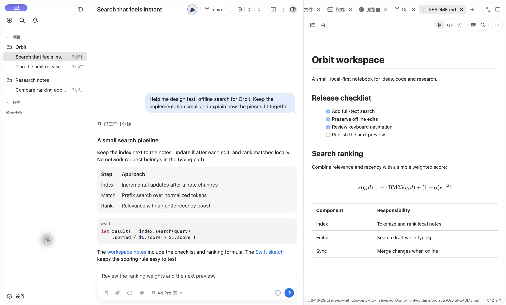
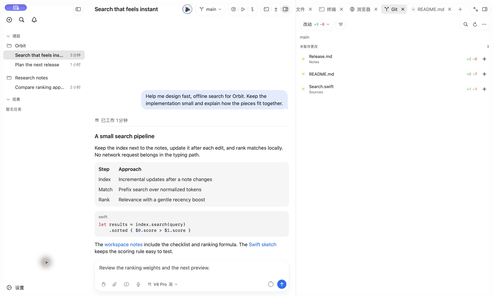
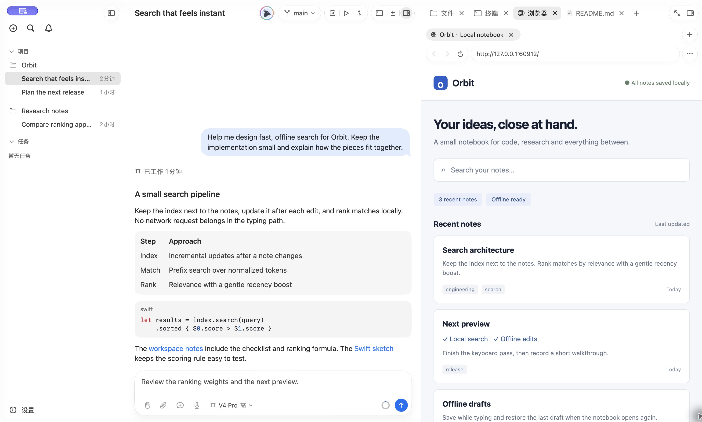
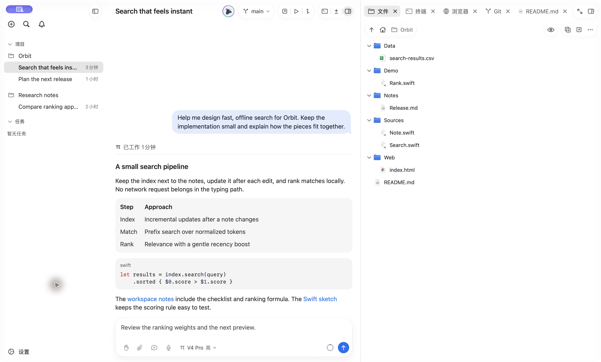
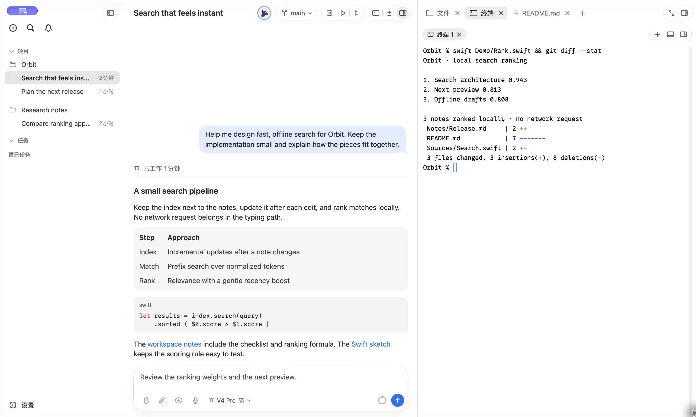

# OMP GUI Native

[English](README.md) | 简体中文

面向 [Oh My Pi（OMP）](https://omp.sh) 的原生 macOS 桌面工作台，使用 SwiftUI 与 AppKit 构建。本项目是 **[Tivano](https://github.com/elijah7x/tivano) 的修改版 fork**，保留 Droppy Code／T3 Code 的来源链及必要署名；与上述项目及 OMP 作者不存在官方隶属或背书关系。

**源码发布状态：**早期开发。本仓库公开源码，不提供已签名／公证安装包。自动更新及继承的发布脚本保持关闭，上游历史版本不代表本 fork 的发行记录。

## 应用截图

当前 macOS 开发版的亮色模式实拍，使用独立的 Orbit 示例项目和预置演示会话。

**原生工作区与 Markdown、数学公式预览**



| Git 变更 | 内嵌浏览器 |
| --- | --- |
|  |  |

| 项目文件 | 侧栏终端 |
| --- | --- |
|  |  |

## 主要功能

- **项目与会话：**原生项目侧栏、历史会话、流式回复、模型与思考级别选择、审批及消息队列。
- **OMP 原生接入：**以独立会话进程接入公开 NDJSON RPC，支持历史续接、原生控制和基于运行进程能力的可选操作。
- **子代理观察：**展示原生 worker 进度、按需读取增量详情，保留 Hydra／Pi Crew 交互。执行、调度及隔离归 OMP 所有，GUI 不另建 Agent 引擎。
- **工作区工具：**文件浏览与预览、显式共享文件上下文、Markdown／公式渲染、内嵌 Chromium 浏览器及 SwiftTerm 终端。
- **Git 与 GitHub：**浏览仓库与变更、复用 GitHub CLI 登录或连接用户自己的 PAT，并选择仓库克隆。本 fork 不附带其他应用的 GitHub OAuth 注册身份。
- **本地听写：**在显式完成语言资源与麦克风权限设置后，通过 macOS 语音识别向草稿添加可编辑文字；不是全双工 Agent 语音通话。

功能受 OMP 版本、模型服务商、账号能力与 macOS 权限约束。请以[当前状态与验收边界](docs/status.md)为准，不以历史截图推断所有场景均已支持。

## 环境要求

- Apple Silicon，**macOS 26 或更新系统**。
- 完整 Xcode、兼容的 macOS SDK 与 Swift 工具链，Git、Python 3。
- 独立安装并认证的 OMP。当前审阅的接入基线为 **OMP 18.13.3**；依赖 SDK 的配置与浏览器接入还要求 **Bun 1.4.4 或更新版本**。安装及账号认证遵循 OMP 官方说明。
- 首次构建需要联网下载固定版本的 Swift 包与 Chromium Embedded Framework。

模型服务商、OAuth／API key、模型角色、MCP、技能、扩展、worker 隔离及任务执行均由外部 OMP 管理。GUI 从登录 shell 或设置中的二进制路径发现 `omp`。

## 从源码构建

```sh
git clone https://github.com/111-test-111/omp-gui-native.git
cd omp-gui-native
make build
```

`make build` 在 `build.noindex/development/Build/Products/Debug/OMP GUI Dev.app` 生成未签名开发应用，**不会安装、启动或替换正在运行的应用**。首次构建会先准备固定版本的浏览器运行时，再构建已检入的 Xcode 工程。

构建依据是 `OMPGUI.xcodeproj`，scheme／target／module 均为 `OMPGUI`。继承的 `project.yml` 尚不能完整重建工程，不应把 XcodeGen 作为常规初始化步骤覆盖现有项目。

使用模型前执行 `omp login`。仓库功能可通过 `gh auth login` 或应用中的用户自有 PAT 认证。只有在本 fork 配置了自己注册的 OAuth App 后，才可提供 GitHub 浏览器登录；源码不附带上游 client identity。

完整前置条件与 worktree 流程见[本地开发](docs/local-development.md)，二进制发现及配置故障见[故障排查](docs/troubleshooting.md)。

## 架构与信任边界

```text
SwiftUI / AppKit
  → ThreadRuntime 与 OMPSession
  → OMPRPC／外部 OMP CLI
  → 原生模型、工具及 worker 执行
```

GUI 将原生事件投影为会话、审批和 worker 面板。宿主工具桥接显式共享的文件上下文、预览定位和浏览器入口；可选能力以原生注册及当前进程回复为依据。

| 方向 | 入口 |
| --- | --- |
| 运行时与职责归属 | [OMP 接入](docs/OMP_INTEGRATION.md) |
| 源码地图 | [架构](docs/architecture.md) |
| 聊天、审批与 worker | [交互指南](docs/chat-workflows.md) |
| 浏览器与本地数据 | [浏览器](docs/browser.md)、[存储与配置](docs/shared-library.md) |
| 开发检查 | [验证规范](docs/verification.md)、[测试入口](tests/README.md) |
| 源码发布与来源 | [源码发布说明](docs/source-release.md)、[仓库历史](docs/repository-history.md) |

OMP 服务商凭据保留在其活动 profile。GUI 另外处理自己的 GitHub 连接 token、浏览器及应用状态，并非完全不接触凭据。不要向模型或不受信任的工作区授予超出预期的权限。

## 开发与验证

```sh
make verify                                    # 仅列出区域，不执行检查。
make verify-plan AREAS="rpc"                    # 查看受影响区域。
make verify TIER=static AREAS="documentation"   # 仅检查文档。
```

当前没有 Xcode test target，也没有默认全量检查。应按改动选择最小区域，使用隔离 fixture，区分静态、功能、原生运行时与人工 GUI 证据。源码／文档检查通过不等于签名包、真实账号或目标环境验收通过。

贡献前阅读 [AGENTS.md](AGENTS.md)，使用独立任务 worktree，不操作其他任务的工作区及运行应用。[打包契约](docs/packaging.md)说明独立的签名和安装前置条件；GitHub 源码公开不等于获得 Apple 签名资格，也不会启用 Tivano 的更新源或发布端点。

## 许可与署名

**Droppy Code by Jordy Spruit (Droppy), https://getdroppycode.app**

OMP GUI Native 是 Tivano 的修改版 fork，沿袭 Droppy Code 与 T3 Code 来源，采用 **GNU AGPL v3.0 及 [LICENSE](LICENSE) 中的附加署名／来源条款**。必须保留 README、About／credits 及源码中的必要声明。许可证不授予 Droppy 名称、图标或其他商标的使用权，详见 [TRADEMARK.md](TRADEMARK.md)。

[THIRD_PARTY_NOTICES.md](THIRD_PARTY_NOTICES.md)保留 T3 Tools Inc. 的 MIT 声明，以及继承组件、SwiftTerm、浏览器资源、字体、图标与后续适配的许可及致谢。第三方名称和标志仅用于说明来源，不代表作者背书。
