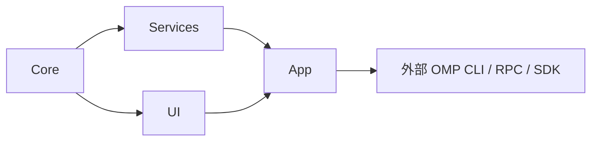

# 架构与源码地图

OMP GUI 是单一 macOS 应用 target。已检入的 [Xcode 工程](../OMPGUI.xcodeproj/project.pbxproj)使用 Swift 6 语言模式、arm64 和 macOS 26 部署目标。目录分层表达依赖方向，当前并未拆成四个独立 Swift module。

## 依赖与职责

箭头从被复用的底层指向使用它的上层。Core 保存模型和通用支持，Services 负责 I/O 与原生协议，UI 提供可复用视图，App 负责窗口、用户操作及状态组合。新增公共类型下沉到合适底层。

| 层 | 入口 | 职责 |
| --- | --- | --- |
| Core | [Models](../OMPGUI/Core/Models)、[Support](../OMPGUI/Core/Support) | 聊天、工具、请求、能力、Hydra、文件预览模型；JSON、分帧、进程和缓存支持 |
| Services | [Providers](../OMPGUI/Services/Providers)、[Store](../OMPGUI/Services/Store) | OMP 原生接入、配置、存储与同步 |
| Services | [Files](../OMPGUI/Services/Files)、[Git](../OMPGUI/Services/Git)、[MCP](../OMPGUI/Services/MCP) | 有界文件读取、Git 差异、原生 MCP 配置编辑 |
| UI | [Chrome](../OMPGUI/UI/Chrome)、[Markdown](../OMPGUI/UI/Markdown)、[Preview](../OMPGUI/UI/Preview)、[Theme](../OMPGUI/UI/Theme) | 公共控件、聊天渲染、预览及主题 |
| App | [AppModel](../OMPGUI/App/AppModel.swift)、[ThreadRuntime](../OMPGUI/App/Runtime/ThreadRuntime.swift)、[WindowManager](../OMPGUI/App/Window/WindowManager.swift) | 库索引、会话状态、用户命令、多窗口及视图生命周期 |
| Core / Services / App | [配置模型](../OMPGUI/Core/Models/BrowserProfiles.swift)、[CEF 运行时](../OMPGUI/Services/Browser/EmbeddedBrowserRuntime.swift)、[会话网页状态](../OMPGUI/App/Browser/BrowserWorkspaceStore.swift)、[浏览器面板](../OMPGUI/App/Browser/BrowserWorkspacePane.swift) | 懒加载 Chromium、稳定原生宿主、全局所选 profile、退出及原生 OMP CDP 附着；见[浏览器契约](browser.md) |
| Core / Services / App | [Cookie 模型与校验](../OMPGUI/Core/Models/BrowserCookieImport.swift)、[原生 Chrome 源读取](../OMPGUI/Services/Browser/ChromeCookieSource.swift)、[隔离写入](../OMPGUI/Services/Browser/BrowserCookieImporter.swift)、[设置事务](../OMPGUI/App/Browser/AppSettings+CookieImport.swift)、[设置入口](../OMPGUI/App/Views/Settings/BrowserSettingsPage.swift) | Services 原生读取所选 Chrome 的 SQLite/WAL 内存快照及 Keychain，严格校验域名哈希和分区；以隐藏的独立 CEF profile 和精确目标的公开 Network 接口分批写入／回读并排空，跳过不可用单条数据并只保留已验证子集；App 成功后添加配置、汇总跳过数并保存下次启动选择 |
| Core / Services / App | [配置与待删除身份](../OMPGUI/Core/Models/BrowserProfiles.swift)、[限域磁盘清理](../OMPGUI/Services/Browser/BrowserProfileCleanup.swift)、[设置删除及启动清理](../OMPGUI/App/Browser/AppSettings+BrowserProfiles.swift) | 确认后移除非默认配置并保存下次启动清理；不删除活跃／保留的 profile，不沿根符号链接向外遍历；启动后台完成后只确认已成功清理的身份 |
| Resources | [原生桥接与资源](../OMPGUI/Resources) | 原生扩展/SDK host、离线 Markdown、本地化与图标 |

## 从输入追踪到界面

1. [ComposerView](../OMPGUI/App/Views/Composer/ComposerView.swift)把操作交给 `ThreadRuntime`。运行时保留草稿及原生投递记录，选择 prompt、steering、follow-up 或停止后发送。
2. [ProviderRegistry](../OMPGUI/Services/Providers/ProviderRegistry.swift)仅提供 OMP；[OMPSession](../OMPGUI/Services/Providers/OMPSession.swift)以执行目录、原生会话文件、模型、权限和配置启动/恢复会话。
3. [OMPRPC](../OMPGUI/Services/Providers/OMPRPC.swift)关联请求 ID 与命令；[StdioProcess](../OMPGUI/Core/Support/StdioProcess.swift)和[分块组装](../OMPGUI/Core/Support/OMPChunkAssembler.swift)在读取路径解析 NDJSON / protocol-v2 帧。
4. [OMPEventDecoder](../OMPGUI/Services/Providers/OMPEventDecoder.swift)把原生事件投影为时间线、工具、用量及 worker 事实。`ThreadRuntime`合并流式刷新并驱动 UI。
5. [Storage](../OMPGUI/Services/Store/Storage.swift)及串行 `DiskWriter`保存 GUI 显示记录；OMP 自己保存原生 JSONL。[数据指南](shared-library.md)说明两者的职责及恢复边界。

[OMPSDKLaunch](../OMPGUI/Services/Providers/OMPSDKLaunch.swift)仅在匹配的 npm SDK 源文件和 Bun 可用时选择 [OMPSDKHost.js](../OMPGUI/Resources/OMPSDKHost.js)。原生启动仍由 OMP 执行；standalone 二进制沿用直接 RPC，不能假定具有 SDK 队列撤回桥。

## 按改动定位

| 改动 | 优先阅读 | 检查示例 |
| --- | --- | --- |
| 连接、取消、超时、退出 | `OMPRPC`、`PendingReplies`、`StdioProcess`、`OMPChunkAssembler` | `rpc` |
| 忙闲、回收、发现 | [OMPActivity](../OMPGUI/Core/Models/OMPActivity.swift)、[发现缓存](../OMPGUI/Services/Providers/OMPDiscoveryCache.swift)、`ThreadRuntime` | `lifecycle` |
| 投递、撤回、上下文 | [OMPSubmission](../OMPGUI/Core/Models/OMPSubmission.swift)、[上下文接口](../OMPGUI/Services/Providers/OMPSession+Context.swift)、[队列桥](../OMPGUI/Resources/OMPQueueControl.js) | `workflows`、`queue` |
| 独立任务、侧栏、归档与恢复 | [归属及任务排序](../OMPGUI/Core/Models/ThreadOrganization.swift)、[归档筛选](../OMPGUI/Core/Models/ArchiveFilter.swift)、[资料库与轮次存储](../OMPGUI/Services/Store/Storage.swift) | `organization`、`recovery`、`selection` |
| 原生目标 | [Goal 模型](../OMPGUI/Core/Models/OMPGoal.swift)、[Goal 接口](../OMPGUI/Services/Providers/OMPSession+Goal.swift)、[运行时桥](../OMPGUI/App/Runtime/ThreadRuntime+OMPGoal.swift)、[目标弹出面板](../OMPGUI/App/Views/Chat/OMPGoalButton.swift) | `goal` |
| 旁问、独立主题与 sidecar 排空 | [旁问模型](../OMPGUI/Core/Models/OMPSideQuestion.swift)、[原生控制器](../OMPGUI/Services/Providers/OMPSideQuestionController.swift)、[运行时动作](../OMPGUI/App/Runtime/ThreadRuntime+SideQuestion.swift)、[原生弹出面板](../OMPGUI/App/Views/Composer/OMPSideQuestionPopover.swift) | `side-question` |
| 审批、提问、草稿 | [OMPInteraction](../OMPGUI/Core/Models/OMPInteraction.swift)、[RequestCards](../OMPGUI/App/Views/Composer/RequestCards.swift)、[QuestionTab](../OMPGUI/App/Views/Composer/QuestionTab.swift) | `interactions`、`questions` |
| 本地听写、语言资源与草稿保护 | [本机录音／识别](../OMPGUI/Services/Dictation/LocalDictationService.swift)、[生命周期](../OMPGUI/App/Runtime/ComposerDictation.swift)、[设置页](../OMPGUI/App/Views/Settings/DictationSettingsPage.swift)、[输入框控件](../OMPGUI/App/Views/Composer/ComposerDictationViews.swift) | `dictation`；导航另选 `settings`，投递修改另选 `workflows` |
| 聊天模型及设置中服务商额度 | [额度投影](../OMPGUI/Core/Models/OMPProviderUsage.swift)、[CLI 读取及可见缓存](../OMPGUI/Services/Providers/OMPProviderUsageReader.swift)、[简洁模型列表](../OMPGUI/App/Views/Composer/NativeModelPicker.swift)、[已配置服务商行](../OMPGUI/App/Views/Settings/ConfiguredProviderRow.swift)、[关键用量展示](../OMPGUI/App/Views/Settings/NativeProviderUsageViews.swift) | `provider-usage`；隐藏／恢复模型另选 `models` |
| 服务商 logo、余额补充与纵向滚动 | [原生图标解析](../OMPGUI/UI/Common/NativeProviderIcon.swift)、[唯一品牌清单](../OMPGUI/Resources/ProviderLogos.json)、[原生身份核对](evaluations/2026-10-26-provider-brand-audit/native-identities.json)、[余额扩展](../OMPGUI/Resources/OMPProviderUsage.js)、[原生凭据桥](../OMPGUI/Resources/OMPModelConfiguration.js)、[局部滚动锁](../OMPGUI/UI/Common/VerticalScrollLock.swift) | `provider-logos`、`provider-usage`；实际原生凭据检查单选 `native:provider-usage` |
| 用量统计与年度活动 | [统计投影](../OMPGUI/Core/Models/UsageStatistics.swift)、[有界资料库读取](../OMPGUI/Services/Store/UsageHistoryReader.swift)、[页面状态](../OMPGUI/App/Views/Settings/UsageSettingsStore.swift)、[用量页与图表](../OMPGUI/App/Views/Settings/UsageSettingsPage.swift) | `usage`、导航变更另选 `settings` |
| 模型、配置、插件、登录 | [OMPCLI](../OMPGUI/Services/Providers/OMPCLI.swift)、[设置](../OMPGUI/Services/Providers/OMPNativeSettings.swift)、[插件](../OMPGUI/Services/Providers/OMPNativePlugins.swift)、[登录](../OMPGUI/Services/Providers/OMPNativeLogin.swift) | `config` |
| Hydra、共享文件上下文 | [AppModel+OMPHydra](../OMPGUI/App/AppModel+OMPHydra.swift)、[worker 接口](../OMPGUI/Services/Providers/OMPSession+Subagents.swift)、[host tools](../OMPGUI/App/AppModel+OMPHostTools.swift) | `workers` |
| 多功能工作区侧栏、预览、Markdown、差异 | [侧栏外壳](../OMPGUI/App/Preview/WorkspaceSidebarPane.swift)、[预览指南](file-preview.md)、[聊天渲染](markdown-rendering.md)、[DiffParser](../OMPGUI/Services/Git/DiffParser.swift) | 按[验证规范](verification.md)选对应模块 |
| 调试过程、停点及变量检查 | [调试模型](../OMPGUI/Core/Models/OMPDebug.swift)、[运行与停点存档](../OMPGUI/Core/Models/OMPDebugHistoryModels.swift)、[历史快照视图](../OMPGUI/App/Preview/DebugSavedInspection.swift)、[原生观测桥](../OMPGUI/Resources/OMPDebugControl.js)、[会话接口](../OMPGUI/Services/Providers/OMPSession+Debug.swift)、[可见检查状态](../OMPGUI/App/Preview/DebugWorkspaceStore.swift)、[调试面板](../OMPGUI/App/Preview/DebugWorkspacePane.swift)、[历史准备缓存](../OMPGUI/App/Preview/DebugHistoryStore.swift)、[会话调试展示](../OMPGUI/App/AppModel+Debug.swift) | `debug`（功能层包含 `debug-bridge`；原生层独立选择） |
| Git 工作区浏览、暂存提交与图谱 | [只读服务](../OMPGUI/Services/Git/GitWorkspaceReader.swift)、[索引事务与原生提交](../OMPGUI/Services/Git/GitWorkspaceWriter.swift)、[行级拓扑](../OMPGUI/Core/Support/GitCommitGraph.swift)、[可见状态](../OMPGUI/App/Preview/GitWorkspaceStore.swift)、[单行顶栏与逐层视图](../OMPGUI/App/Preview/GitWorkspacePane.swift) | `git-browser`、`git-commit` |
| 会话记录、请求采集与分页详情 | [记录模型](../OMPGUI/Core/Models/OMPSessionRecord.swift)、[轮次树投影](../OMPGUI/Core/Models/OMPSessionRecordTree.swift)、[树行与可滚动值](../OMPGUI/App/Preview/SessionHistoryTreeViews.swift)、[有界日志索引](../OMPGUI/Services/Providers/OMPSessionRecordReader.swift)、[采集器](../OMPGUI/Resources/OMPRequestCapture.js)、[请求 sidecar 读取](../OMPGUI/Services/Providers/OMPRequestRecordStore.swift)、[可见读取与导航](../OMPGUI/App/Preview/SessionHistoryStore.swift)、[顶栏与全屏分栏](../OMPGUI/App/Preview/SessionHistoryPane.swift) | `session-records`、`request-capture` |
| 侧栏上下文检查 | [分项与累计模型](../OMPGUI/Core/Models/OMPContextInspection.swift)、[原生只读桥](../OMPGUI/Resources/OMPContextControl.js)、[请求组成](../OMPGUI/Resources/OMPContextComposition.js)、[有界读取](../OMPGUI/Services/Providers/OMPContextInspectionReader.swift)、[可见刷新](../OMPGUI/App/Preview/ContextWorkspaceStore.swift)、[快照报告](../OMPGUI/App/Preview/ContextWorkspaceReport.swift)、[面板](../OMPGUI/App/Preview/ContextWorkspacePane.swift) | `context-inspection`（含 `context-bridge`）、`request-capture` |

这些是定位提示，非自动追加检查列表。编译改动做一次增量构建；文档/工具变更只选静态层。

## 状态与资源约束

- 可观察 UI 状态主要在 `@MainActor`；文件、历史和协议重处理使用已有后台路径。取消任务仍须保留 generation、原生 session、request 和 worker observation 校验，拒绝迟到结果。
- 接收输入、消费输入、单轮结束、会话全部 settled 是不同事实。回收要求原生工作已结束且保存安全。SDK 证明的 next-turn 上下文可停止显示忙碌，但仍阻止回收。
- Hydra 使用进程级 progress 订阅。可见日志消费者各自持有读取租约，按字节游标补读；隐藏缓存视图也必须释放自己的租约。
- 预览只保留可见 reader。聊天 Markdown 保留 TextKit 正文，公式使用共享离线 MathJax 的透明图片附件；文档 Markdown 使用离线 WebKit，两个入口共用公式配置与资源，分别维护 Markdown 语法范围。
- 保留缓冲、缓存和渲染预算，见[文件预览](file-preview.md)、[原生接入](OMP_INTEGRATION.md)及生产常量。生产性能测量默认关闭；离屏 helper 不能认证整应用指标。

OMP 拥有认证、模型、工具执行、MCP 连接、扩展、技能、worker 调度、隔离及结果应用。GUI 的投递记录和继承的兼容模型不构成另一套执行器。旧 runtime 标识只供显式导入档案与 UI fixture 解码；约束以 [AGENTS.md](../AGENTS.md) 为准。
