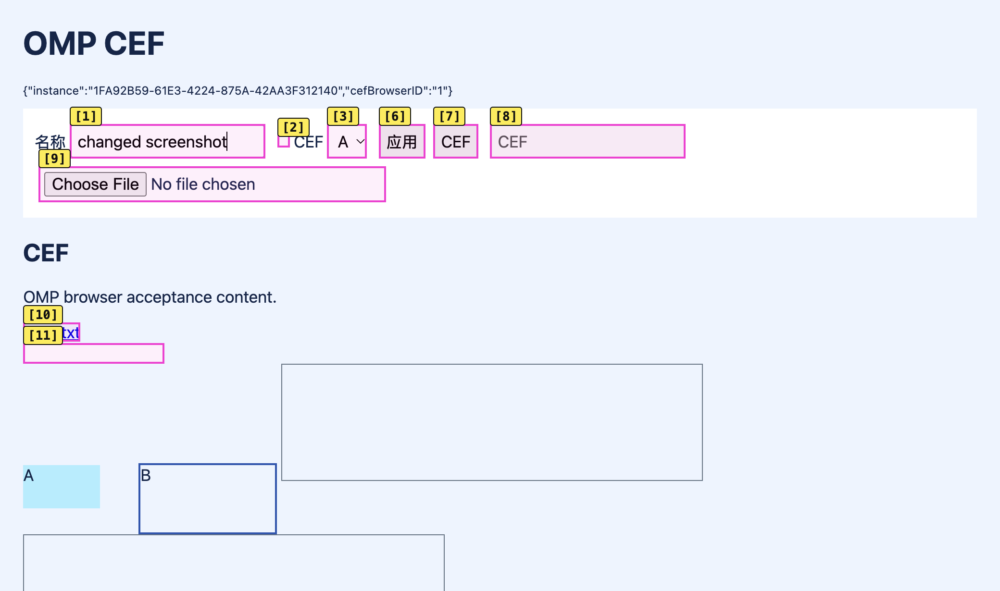
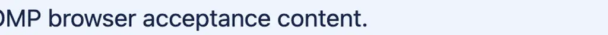
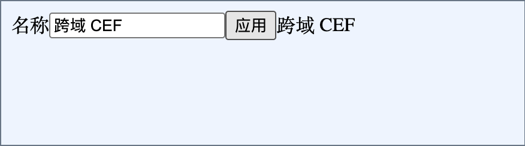

# CEF 内嵌页面的 OMP Browser 扩展验收（2026-10-27）

后续的 iframe 截图与对话框修复见[修复验收](cef-browser-repairs-2026-10-27.md)；下文保留修复前的结果和限制。

Owner 要求继续检查 OMP 的其他 Browser 能力。本次仍使用[独立 CefWebView 原型](cef-browser-prototype-2026-10-27.md)，没有向生产 GUI target 添加 Chromium 或浏览器入口。真实安装的 OMP 为 18.12.5，CefSwift 固定 `ba6ebff9e232529289662a84704ade1240563031`，CEF 154.0.34 / Chromium 154.0.8037.98；环境为同一台 arm64 macOS。只访问隔离 loopback fixture，未发送模型 prompt、读取日常账号或启动子代理。

## 结果

[紧凑证据](../evaluations/2026-10-27-cef-capabilities/summary.json)汇总五次有范围的运行：13 组通过、1 组部分通过、1 组失败，保留 42 条已通过的自动断言及图像人工复核。它不是单次全绿运行，也不覆盖任意网站。此前 21 项输入、同页身份、标签路由、取消与关闭恢复证据继续作为独立基线。

| 能力组 | 结果 | 实际覆盖 |
| --- | --- | --- |
| 导航 | 通过 | goto、back、forward、reload、pushState、waitForUrl；原生注入 UUID 仍与内嵌页一致 |
| 选择器与读取 | 通过，带用法边界 | 数字句柄、ARIA ref、XPath、test-id、role、open Shadow DOM；文本、HTML、Markdown、可见性、禁用状态、几何和样式 |
| 表单 | 通过 | check/uncheck、select、focus/type、hover、dblclick，核对实际 DOM 值 |
| 指针与滚动 | 通过 | clickAt、drag、scrollIntoView、scroll、wheel，核对拖放目标及视口位置 |
| JavaScript | 通过 | 异步 evaluate、tab.run 的 Puppeteer facade、文档起始脚本安装／重载／移除 |
| iframe | 部分通过 | 同源及跨站 frame 的 fill/click/text、ARIA；直接 frame 截图区域错误，宿主 iframe 元素截图正确 |
| 存储 | 通过 | cookies、local/session storage、save/load state；同 profile 同源标签共享 localStorage，不能当作安全隔离 |
| 网络 | 通过 | requests/detail/body、HAR、route fulfill/abort/unroute、真实 response wait |
| 上传 | 通过 | uploadFile；页面读取中文文件并 POST，服务端收到完整内容 |
| 下载 | 通过 | waitForDownload/downloads 的完成元数据，文件内容及隔离路径 |
| 图像与 PDF | 通过 | 元素截图、ifChanged 首次／未变／修改、实际元素标注、Page.printToPDF 的 PDF 文件 |
| 诊断 | 通过 | console、JavaScript error、DOM/lifecycle metrics、trace/profile JSON、vitals；仅短功能探针，不作为性能基准 |
| 仿真 | 通过 | viewport、媒体偏好、时区、UA、HTTP header、offline、devices；A 的 viewport 修改没有改变 B |
| 可选能力发现 | 局部通过 | WebMCP 返回 ready/空 tools；reactEnable 成功，非 React 页面 reactTree 为空。未认证真实工具调用或 React 组件操作 |
| 对话框 | 失败 | setDialogs 后 confirm 点击超时，随后 OMP worker 被终止；退出也受阻，不能认证 accept/dismiss/prompt/alert |

原生宿主显式调用 `setAccessibilityEnabled(true)`。截图标注复核显示实际编号和框线，默认整页 observe 返回 14 个元素目标。局部 `observe({selector:'#controls'})` 在无名称容器上返回空数组；`includeAll:true` 返回 22 项并成功用数字句柄填写输入。安装版 Puppeteer 的 AX snapshot 在 interesting-only 根节点过滤后只返回展平结果的第一项；本 fixture 第一项是静态标签。这是已观察到的 scoped snapshot 用法边界，未证明为 CEF 独有问题。

## 两个不能忽略的缺口

跨站 iframe 的输入及输出均为 `跨域 CEF`，顶层页面无法通过 DOM 同源访问它。`cross.screenshot('body')` 生成的文件却是主页面文章区域；只检查文件存在会误报成功。读取安装版 OMP `frames.ts` 后，确认它直接走 frame ElementHandle 的 screenshot；本次保留错误图，尚未确定偏移错误属于 OMP、其 Puppeteer 或 CEF 哪一层。通过顶层 `a.screenshot({selector:'#cross-frame',format:'png'})` 截取宿主 iframe 元素，视觉内容正确。该方式能截取当前可见 frame 区域，不能代替 iframe 内任意长元素的完整截图。

对话框组在独立的新宿主上仍复现 confirm 点击超时，OMP 随后报 `Browser code execution hung past grace; tab killed`。CefSwift 的 `BrowserClient.makeJSDialogHandler` 默认截获 JavaScript dialog，调用 `CefJSDialogPresenter` 的同步 `NSAlert.runModal()`；OMP 则依赖 Puppeteer Page dialog 事件及 CDP accept/dismiss。这个组合需要单独适配，不能声称现有 CDP 通路已完成对话框支持。还需要定位实际事件与原生回调时序，不能仅凭源码把整个挂起归因于 CEF 内核。

该次宿主的控制文件退出在 15 秒内未完成，SIGTERM 后 5 秒仍未完成，旧驱动抛出 TimeoutExpired；稍后的 PID 检查确认实例已退出，不计为正常退出通过。驱动现已补充只针对自己创建的宿主升级到 kill 的有界清理，保留失败状态；没有为取得成功结果重复弹窗运行。原型没有操作主 GUI 进程。

## 验证方法与证据复用

所有操作都经过实际 OMP SDK → Eval → Browser prelude → Puppeteer CDP，附着原生两页的唯一 UUID，没有另启 Chromium。frame fixture 使用 `127.0.0.1` 与 `localhost` 不同站点；上传／下载和 HAR 等产物仅为合成内容。下载使用公开 `downloads` 参数，并同时限制原生下载回调的目的地，避免写入 owner Downloads。

初次运行中的 selector/frame screenshot 参数错误、Eval 长行截断造成的 JSON 解析失败、下载参数名错误均先对照安装版源码修正。早期 dialog 失败后的组只算未实际执行，后续在新宿主补测。通过的相关路径复用证据，只重跑受影响失败项和图像区域复核。新增的 `includeAll` 保留数字句柄的有效断言，未以跳过输入验证掩盖空观察结果。

原始 run ID 与每组对应关系见 JSON；完整 app/OMP 日志、native-state、状态导出、HAR、trace/profile 保存在该 worktree 的 `build.noindex/cef-prototype/runs/`。独立 helper 的增量编译已通过；只对验证工具／文档执行 `make verify TIER=static AREAS="documentation harness syntax"`，没有因这些改动重建或启动主 GUI。PDF 可从[fixture.pdf](../evaluations/2026-10-27-cef-capabilities/fixture.pdf)查看。

仍未认证：系统剪贴板、真实 React 组件检查和动作、WebMCP 工具调用、视频录制、外部网站／登录／权限提示、IME composition、发布签名及 Chromium sandbox、耗电与整应用性能。宿主仍是关闭 sandbox、mock key storage 的本地开发原型。
