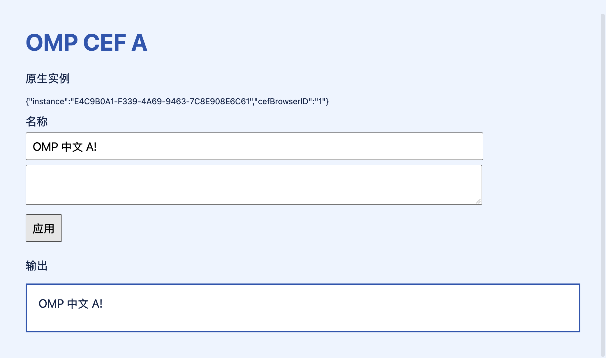
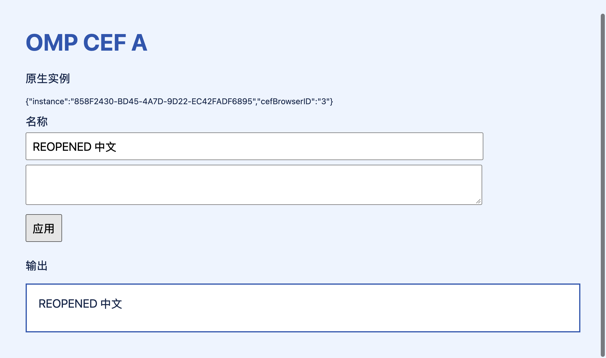

# CefWebView + OMP CDP 原型验收（2026-10-27）

Owner 明确要求在独立 worktree 制作并运行最小原型，验证同一个内嵌页面的输入、截图、多标签隔离、取消与关闭恢复。本记录只授权并描述这次本地原型，不代表生产浏览器功能或发布签名已经完成。

## 实现与环境

- 工作分支：`codex/cef-browser-prototype`；原型位于 [独立验收包](../../tests/acceptance/cef_browser/README.md)。没有向生产 OMP GUI target 添加 CEF 依赖或浏览器入口。
- macOS 27.2（26B118）、arm64；本机 npm OMP 18.12.5，调用公开 SDK 的真实 Eval 工具与 Browser prelude，再经 Puppeteer CDP 连接 CEF。没有发送模型 prompt，没有子代理。
- CefSwift 固定提交 `ba6ebff9e232529289662a84704ade1240563031`；其 manifest 固定 CEF 154.0.34 / Chromium 154.0.8037.98。arm64 minimal 包 132,210,884 字节，下载后核对 manifest SHA-1。
- 独立可见 Alloy `CefWebView` 宿主使用两份原生实例 UUID 与 CEF browser ID。页面来自本次 loopback HTTP fixture；浏览器、OMP、HOME 与证据目录均隔离在本 worktree 的 `build.noindex/cef-prototype/`。没有读取日常账号、GUI 库或 OMP profile。
- 新界面文字保存在生产唯一 string catalog，原型构建时从该目录生成自己的 bundle strings。原型为 ad-hoc 本地开发宿主，使用 mock key storage、关闭 Chromium sandbox，不分发或浏览不可信内容。

## 最终结果

[紧凑证据](../evaluations/2026-10-27-cef-browser/summary.json)保留最终同一会话的 21 项检查、原生运行版本、时长及截图摘要。原始 run ID 为 `8325fdbcdacd439181ce883787ee7eb3`，完整 result、native proofs、控制 ACK 与 app/OMP 日志保存在该 worktree 的生成目录。

| 范围 | 结果与边界 |
| --- | --- |
| 同一内嵌页面 | OMP 观察到的两个 UUID 与 CEF browser ID，和 Swift 宿主独立注入的标记逐一对应。CDP 起始发现恰好两个页面。 |
| 输入 | 中文 `fill`、键盘 `press`、点击提交，由 Swift 所拥有的同一 CefBrowser 再次读取 DOM 状态确认；记录到 trusted keydown。 |
| 多标签 | 操作后台 B 时 A 保持选中，A 的内容不变；A 关闭及连接刷新后 B 的 browser ID 与已输入内容保留。此处验证目标路由，不认证权限或跨 profile 安全隔离。 |
| 截图 | OMP 返回真实 PNG，2080×1230 原始像素；结果同时带模型图片及 CSS 坐标缩放提示。已查看截图，并在真实原型窗口切换 A/B 核对内容。 |
| 取消 | 对 20,000 ms 等待发出真实 AbortSignal，约 604 ms 返回 `Command aborted`；后续写入没有执行，已有输入保留，随后重新获取句柄可继续填写。超时返回不计为取消通过。 |
| 句柄释放 | `tab.close()` 与 `browser.close({all:true})` 只释放附着句柄，两个用户拥有的原生标签仍在。 |
| 原生关闭与恢复 | 关闭 A 后，旧句柄报 detached-frame 错误，不转向 B。重建 A 获得新原生 ID，刷新附着连接后可填入 `REOPENED 中文`；B 内容保持。 |

真实窗口复核确认：A 显示原生 browser ID 3 与 `REOPENED 中文`；B 保持 browser ID 2、`OMP 中文 B` 及两行独立内容。CUA 的顶层 AX 树只看到宿主控件，网页内容使用可见截图核对；没有据此声称完整 VoiceOver 已通过。

## 发现并处理的集成问题

1. 直接把 `CefWebView` 放在可变 SwiftUI 标签集合中，关闭 A 时曾导致 B 的 representable 也被拆卸，两个 CDP 页面都消失。固定的原生容器分别持有每个标签自己的 `NSHostingView`，关闭只释放目标宿主后，B 保留检查通过。
2. 原生关闭/重建后，仅释放 A 的 OMP 句柄重新打开，曾触发 `A browser tab is not ready`。OMP 的目标选择代码会拒绝含不可读 frame 的发现结果，避免误选其他标签。通过公开 Browser API 释放附着句柄、重建连接和目标映射后恢复；没有修改 OMP 源码。此策略会重建该连接的全部 OMP 句柄，原生标签及输入保留。
3. CefSwift 的终止路径可能在 CEF `on_before_close` 回调内再次进入 shutdown，早期退出日志出现 observer/context 生命周期告警。原型先释放 native hosts，等关闭在后续 run-loop tick 完成后再请求退出；后续聚焦运行没有复现这组告警。它不构成任意站点关闭弹窗的完整验收。

早期验收脚本的多行字符串转义、默认图片格式及等待时间单位错误均已修正：OMP 默认可能保存 WebP，因此显式要求 PNG；Browser 等待的 timeout 使用毫秒。早期自然超时结果不算取消证据。最终取消由真实 AbortSignal 及中断返回共同确认。

## 验证与剩余边界

应用 `make build` 通过。首次构建完成编译后，字符串文件格式整理触发了输入变更保护；文件稳定后的一次增量构建确认成功。原型编译、真实可见运行和两个聚焦路径通过后，在同一会话串联全部行为得到 21 项通过结果；之后不再重复 GUI 检查。

相关静态范围为 `documentation harness syntax`。GUI 验收保持在 `tests/acceptance/`，没有加入自动 registry 或默认检查。

未认证：生产 Developer ID/hardened-runtime/Chromium sandbox 组合、实际网站与登录、真实模型规划、IME 组合输入、复杂 iframe、下载上传、网络拦截完整性、权限隔离、能耗与整应用性能。现有生产签名/打包流程保持原样；该开发宿主不构成发布包。
