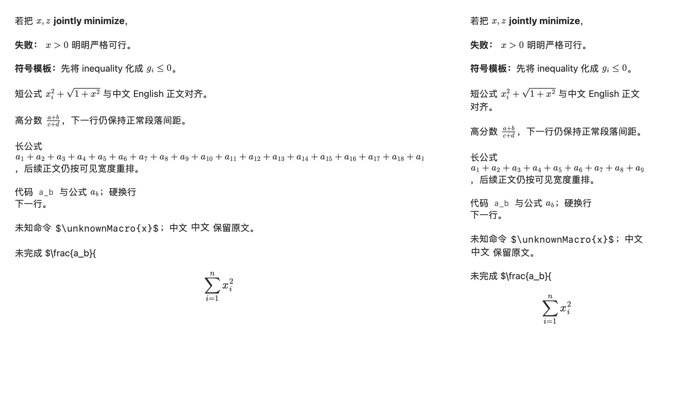
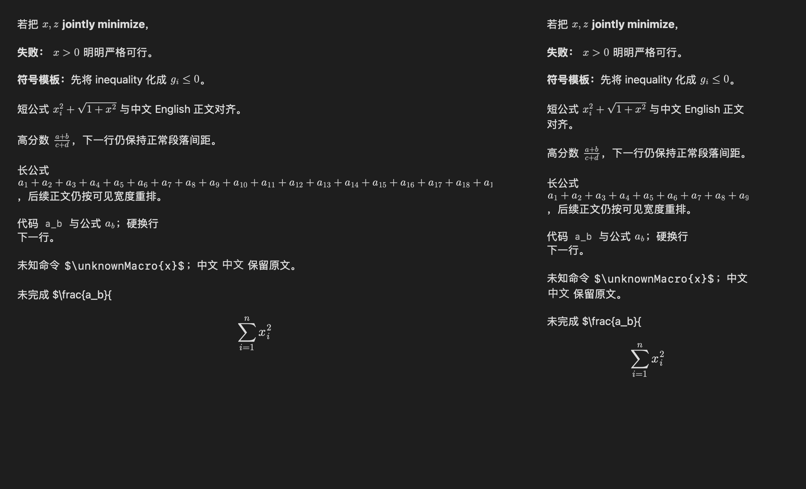

# 聊天公式对齐与首次渲染优化 2026 年 10 月 18 日

Dev 0.1.130 / build 131 修复行内公式随标点而上下移动、中文标点附近加粗失效，并收紧公式间隔。原生正文与 2× 透明图片附件继续保留，当前契约见[聊天 Markdown](../markdown-rendering.md)。

## 排版修复

原实现将每张公式的全部墨迹外框居中，逗号、下标、上标会改变外框中心。现在保留 MathJax 的基线、数学轴及裁切的像素偏移，以稳定轴线对齐原生文字中心。新增像素检查比较 `x`、`x,z`、`x>0`、`x_i`、`x^2`、`x,` 中第一个 x 的实际墨迹高度，允许的栅格误差为 0.6 pt；同时复核 12–22 pt、3× 图片及亮暗主题。

截图中的加粗原文为 `**符号模板：**先将…`，Foundation 的标点边界规则使它保持字面文本。兼容处理让成对标记内部临时满足解析边界，解析后移除临时字符，保留中文、空白、链接和嵌套样式；代码、转义、网址目标及受保护的 TeX 不参与改写。新增检查还发现 Foundation 会丢弃链接标签内的普通加粗意图，因此显式保留该范围的加粗，同时保留链接属性。

图 4 的两个等式属于同一个公式，原文为 `w=\sum_i\lambda_i y_i s^i,\qquad y^\top\lambda=0.`。聊天将 `\qquad` 从 2 em 收紧至 1 em，图片两侧透明边距从各 2 pt 减到各 1 pt。复制仍导出原始 TeX；文件预览采用标准间隔。

## 首次渲染

共享 worker 优先提交当前可见附件，先输出最多 8 个公式，后续以最多 32 个合并 WebKit 桥接和快照。MathJax 的[公开沙箱](https://docs.mathjax.org/en/v4.0/input/tex/extensions/begingroup.html)隔离每条公式的本地及全局定义，输入解析器和字体继续复用。混合批次超出图片预算时按半拆分，避免一个超宽公式使其余公式都退化为逐条快照。所有失败分支均结束相关附件的等待。

同一 Apple M5、24 GiB、macOS 27.2 环境，链接生产 Dev 模块；每轮重建 WebView，提交 96 个不同的分数和根号公式，15 pt / 2×。三轮在同一 helper 进程内执行，后两轮仍共享进程及系统资源缓存；这是离屏资源就绪时间。原始数据见[基线](../evaluations/2026-10-18-chat-math-refinements/cold-baseline.json)、[修订后](../evaluations/2026-10-18-chat-math-refinements/cold-candidate.json)与[环境和汇总](../evaluations/2026-10-18-chat-math-refinements/comparison.json)。

| 指标 | 基线 4218ecc | 修订后 |
| --- | --- | --- |
| 首轮首批就绪 | 332 ms | 256 ms |
| 首轮 96 条全部就绪 | 603 ms | 426 ms |
| 三轮首批就绪中位数 | 143 ms | 128 ms |
| 三轮全部就绪中位数 | 426 ms | 295 ms |
| 每轮成功快照次数 | 12 | 4 |
| 主线程按 16 ms sleep 节拍提交 24 条公式的总时长 | 456 ms | 457 ms |

全部就绪中位数缩短约 31%。节拍回放包含提交时间，只用于这条离屏路径的比较，不代表独立输入时钟、完整 GUI 滚动或 GPU 呈现延迟。可见附件优先调度在本轮没有新增真实窗口测量。缓存仍为 256 项 / 16 MiB 估算成本，atlas 仍限制 1,600 万像素及单边 16,384 像素，闲置 20 秒释放共享 WebView；本轮没有追加进程内存采样。

## 验证

`make build`、`markdown-parser`、`markdown-layout`、`markdown-preview`、`markdown-math` 及独立 `benchmark:chat-math-cold` 通过。新加的混合批次检查把一个 6000 px 宽的有效公式与普通公式放入冷队列，确认拆批后每条均就绪，并保留其余批次合并。

构建、解析与预览结果见[解析报告](../evaluations/2026-10-18-chat-math-refinements/parser-report.json)、[布局和文件预览报告](../evaluations/2026-10-18-chat-math-refinements/layout-preview-report.json)、[最终公式报告](../evaluations/2026-10-18-chat-math-refinements/math-report.json)、[基线测量报告](../evaluations/2026-10-18-chat-math-refinements/benchmark-baseline-report.json)及[最终测量报告](../evaluations/2026-10-18-chat-math-refinements/benchmark-candidate-report.json)。源码和 binary 指纹保留在报告中。真实聊天流式与滚动的既有范围见[接入验收](chat-mathjax-integration-2026-10-18.md)，不将旧的整应用测量扩张为本修订的性能认证。
