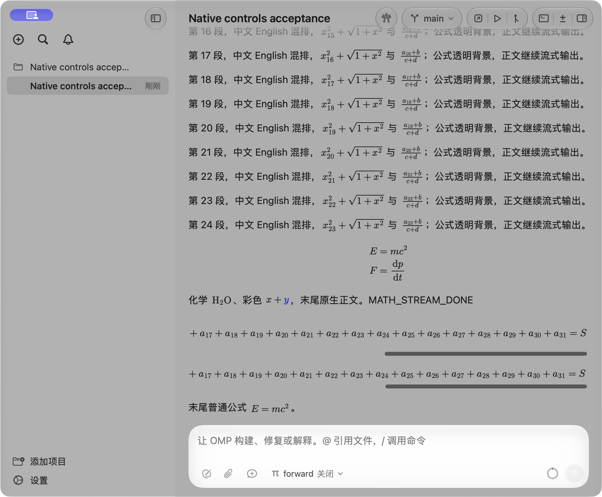

# 聊天 MathJax 图片附件接入与验收（2026-10-18）

采用共享 MathJax 4.1.3 CHTML / New Computer Modern 的透明图片附件，保留原生 TextKit 正文、链接、选择和复制。Dev 为 0.1.129 / build 130。当前契约见[聊天 Markdown](../markdown-rendering.md)，历史选型见[原型评估](mathjax-attachment-evaluation-2026-10-18.md)。

## 接入与边界

- 文件预览与聊天从同一 `math-engine.js` 生成配置，使用已检入的离线字体及扩展；聊天共用一个按需启动的隐藏 WebView，不把正文放入 WebKit。
- 图片默认每点 2 像素；1×/2× 复用，较高倍率重新生成，最高 4×。升级期间保留已有图片；字号变化重新生成，宽度、主题及选择变化不重新排版。
- 按垂直墨迹裁切、加对称透明边距，以原生字体 cap-height 中心对齐行内公式；保留 TeX 水平留白。普通墨迹按原生语义颜色及流式渐显绘制，显式 TeX 彩色保留，选中时使用原生选中文字颜色。
- 完整公式暂显源码，异步完成只失效相关视图的布局，保留选区字符位置。未闭合输入不调用 MathJax；失败保留源码。导出附件仍还原原始 TeX。
- 缓存目标为 256 项 / 16 MiB 估算图片成本；临时 atlas 限制 1,600 万像素、单边 16,384 像素。可见附件、WebKit 和整个进程不受该缓存数字约束。最后一批工作后闲置 20 秒释放 WebView；已有附件继续绘制，新公式再启动。
- SwiftMath 已从应用依赖移除，原始许可与署名保留。历史比较器使用从 fd7776e 冻结的测试基线，不能再称为当前生产实现。

## 宽度相关修复

原型不足以证明实际聊天的宽度行为。本轮补齐了以下生产路径：

1. 冷历史合并的连续原生正文同样拥有公式横向滚动宿主。
2. SwiftUI 的临时宽度探测不再成为最终文本容器宽度；最终布局按真实视口校正，短块公式保持居中。
3. WebView 的绘制面按 atlas 实际宽高扩展，避免快照在默认 720 × 900 点之外变透明。功能检查用超过该宽高的公式及末尾彩色标记验证完整像素。
4. TextKit 对超宽附件另有内部裁切。原生视图正常绘制后，按完整附件范围绘制一次溢出公式，并保留尾部的选中色、选区背景与复制 LaTeX 命中范围；普通正文的换行宽度不随附件扩张。

功能检查覆盖 760 → 280 → 540 → 280 → 760 点往返、冷正文/流式段落/块公式、横向尾部、短块公式居中、稳定行高及不重复生成图片。实际窗口由 1320 点缩至 920 点，聊天正文视口从 760 点变为 612 点；长行内公式文档宽度保持 1200 点，块公式为 1204 点。侧栏关闭/恢复另通过真实 UI 操作复核。

## 验证证据

机器为 Apple M5、24 GiB、macOS 27.2，实际窗口倍率 2×。使用真实 OMP 18.11.2、生产 ThreadRuntime/时间线及隔离的本地 SSE provider；没有外部模型、账号或真实工作目录请求。GUI library、HOME/profile、工作目录及偏好均为本次隔离实例，保留了其他运行实例。

- `make build` 通过；随后只有 DEBUG 验收选区定位调整，使用同入口增量构建并只重跑该验收项。
- [最终数学功能报告](../evaluations/2026-10-18-chat-mathjax/functional-math.json)：解析/复制、透明 alpha、前景/显式彩色/选中色、中心对齐、12–22 点字号、3× 像素密度、超宽/超高末尾像素、原生尾部绘制与命中、宽度往返、缓存及释放后重启。
- [文件预览报告](../evaluations/2026-10-18-chat-mathjax/functional-preview.json)：共享启动配置提取后的离线预览回归通过；后续仅修改聊天原生路径，复用通过证据。
- [真实聊天数据](../evaluations/2026-10-18-chat-mathjax/math-checks.json)与[资源汇总](../evaluations/2026-10-18-chat-mathjax/summary.json)；完整采样及 PID/start 身份见[压缩账本](../evaluations/2026-10-18-chat-mathjax/resources.json.gz)。

本次回复先建立 55 个含公式历史段落，再以独立时钟每 128 ms 到达 12 个 Unicode 字符，新增 54 个公式。操作者在流式期间真实上滚，读取同一历史段落的视口位置；等待输入的状态见[阶段日志](../evaluations/2026-10-18-chat-mathjax/math-phases.jsonl)。流式来源并不等待渲染器。

| 定向测量 | 结果 |
| --- | --- |
| 新公式从请求到可见原生绘制回调 | P95 43.70 ms，20 个可见新公式样本 |
| 16 ms 主线程心跳 | P95 20.25 ms，最大 132.96 ms |
| 上滚后的可见阅读锚点 | 「历史段落 25：」始终在视口 y=73 点，漂移 0 |
| 主题 / 仅宽度变化的额外排版 | 均为 0 |
| 两个长公式横向尾部误差 | 均为 0 点，截图可见 a₃₁ = S |
| 闲置回收 | 20 秒后 WebView 已释放；图像保留可绘制 |
| worker 创建次数 | 2；人工侧栏复核期间曾自动闲置回收，18 点字号请求重新启动成功 |

绘制回调发生在 WindowServer 最终合成之前，心跳也不是帧率；采样包含 PNG 捕获开销。该单次本地流不证明外部模型延迟、GPU 呈现 p95 或所有高速率负载。

| 阶段采样中位数 | GUI 物理 footprint | 明确归属的 WebKit footprint 合计 |
| --- | --- | --- |
| 继续流式、上滚阅读历史（32 个样本） | 76.87 MiB | 108.13 MiB |
| 最终闲置、尚未释放（36 个样本） | 99.36 MiB | 77.81 MiB |
| 释放后（20 个样本） | 99.33 MiB | 9.81 MiB |

GUI 观察峰值 145.11 MiB；WebContent / Networking / GPU 各自观察峰值为 122.55 / 4.41 / 56.70 MiB，这些分角色峰值不应相加当作同一时刻峰值。保留的 GPU 服务等使释放后数值不归零。首次启动有 1 个 WebKit 归属发现不完整样本，其余 194 个样本完整；早期未分类后代及 OMP footprint 单独保留，不归为渲染器。进程 footprint 合计不等于系统唯一物理内存；本轮没有相同负载的整应用 SwiftMath 基线，不能由这些绝对值推导内存增量。

## 失败、修复及剩余范围

早期实际窗口检查发现了快照视口裁切和 TextKit 尾部裁切，均修复并补了像素/原生绘制断言。回收后重启曾出现导航与首个合成面的竞态：现在等待当前导航完成、隔离旧回调，并对一次空快照做有界重试。

验收驱动最初直接修改滚动坐标，未触发生产代码的真实滚动输入判断；该结果不作为阅读验收。后改为真实滚轮，并在手势结束后记录可见段落锚点及截图。早期人工步骤超时、以及手势晚于流式结束的运行也不算通过。本报告使用最终完整运行，不以重复运行中的有利数字替换失败记录。

原先选区截图误选了仍在原生层级中、但实际不在视口内的视图；已按真实视口坐标修正定位，仅追加定向选区验收。[选区检查](../evaluations/2026-10-18-chat-mathjax/selection-checks.json)及[截图](../evaluations/2026-10-18-chat-mathjax/math-selected-light.png)单独保留，不重复流式负载。

物理显示器间的倍率切换、3× 以上实体屏幕、完整 VoiceOver、系统睡眠/唤醒及外部账号/模型未在本轮验证。3× 仅为生产快照路径的功能模拟。停止于本轮选定检查，不扩张为历史性能矩阵。
