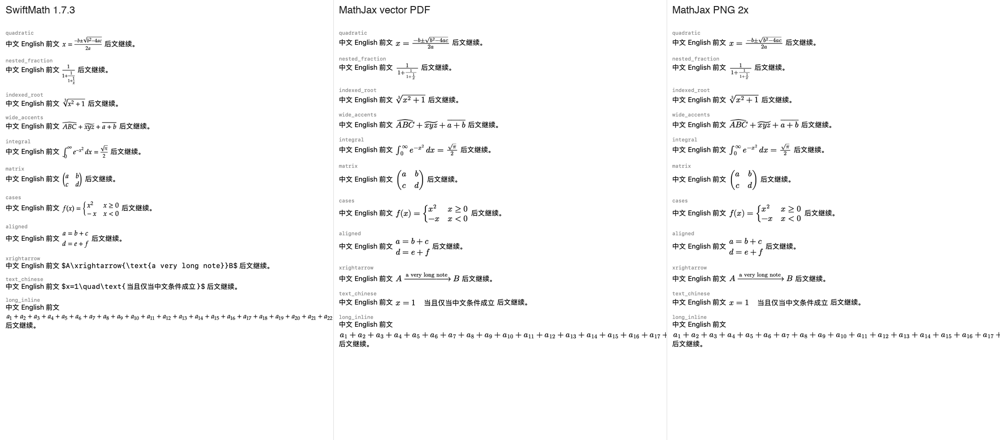

# 共享 MathJax 原生公式附件原型评估

2026-10-18，在独立任务 worktree 中比较生产 SwiftMath、共享 MathJax PDF 矢量附件及 2× 图片附件。原型保留原生 Markdown 解析、TextKit 1 正文、链接和 TeX 复制，没有改变产品聊天渲染器，也没有启动、安装或打包 OMP GUI。

本机结果支持把 **2× 图片附件作为后续聊天接入的优先候选**：它提供与 PDF 相同的语法覆盖和 CHTML 几何，批量生成及缓存绘制更快。PDF 的优势是无损放大和更小的编码缓存，但不足以抵消本原型的导出、逐附件区域绘制成本。两者运行中的共享 WebKit 占用相近，迁移需要明确接受这项固定成本，并设计闲置/隐藏时的宿主释放。

## 排版与兼容性

| 项目 | SwiftMath | MathJax PDF | MathJax 2× 图片 |
| --- | ---: | ---: | ---: |
| 有效样例，68 条 | 36 | 68 | 68 |
| 正确回退无效输入，6 条 | 4 | 6 | 6 |
| 数学字体 | Asana Math | New Computer Modern | New Computer Modern |
| 中文公式文本 | 当前字体策略整体回退 | PingFang SC 回退，实际字形可见 | 同 PDF |
| 原生正文、链接及原始 TeX 复制 | 保留 | 检查通过 | 检查通过 |
| 放大质量 | 矢量 | 矢量 | 超过生成倍率后变软 |

样例有意包含扩展和边界，以上不是日常对话成功率或完整 LaTeX 兼容率。MathJax 保留错误源码，未完成公式不进入共享绘制器；旧消息的在途导出也不能覆盖替换后的消息。

检查了 696/280 pt、浅/深色、中英混排、分数、根号、装饰符、矩阵、分段、扩展箭头和中文公式。两条 MathJax 路径的基线、行高和显式多行结构一致；NewCM 与 Asana 的大小、间距及行盒存在差异，不能概括为所有常用公式均更美观。对原先直接显示源码的扩展箭头及中文，改善明确。

超宽附件保持固有字号，不压缩成窄图。当前样图展示可见窗口内的部分长公式；附件本身仍为不可拆分的一个字形，不能继承浏览器的行内断行。完整聊天的横向滚动、选区重绘和流式渐显需要后续接入验收。

四份 PDF 图集均包含嵌入字体，没有图像 XObject；中文图集包含嵌入的 PingFang SC。CGPDF 和 Poppler 可读取，4× 渲染检查中根号、分数线、矩阵括号完整。pypdf 对 Quartz 的部分未使用交叉引用项给出 offset 0 警告，未阻止字体/资源读取；保留原始 PDF 以便核对。[矢量图集](../evaluations/2026-10-18-mathjax-attachments/pdf-atlas-light-0.pdf)、[4× PDF 绘制](../evaluations/2026-10-18-mathjax-attachments/pdf-zoom-4x.png)、[同一 2× 图片放大](../evaluations/2026-10-18-mathjax-attachments/png-zoom-4x.png)。

## 生成与绘制性能

Apple M5、24 GiB、macOS 27.2（26B5101f）、Swift 6.4 Release helper，基线 `dd7a003`。SwiftMath 1.7.3 与已打包的 MathJax 4.1.3 CHTML/NewCM，数学名义字号 15 pt。用原生支持的 28 个核心公式循环组合并附加不同数值，确保新缓存键；绘制同为 720×900 pt、2×，只画可见字形。

下表为中位数，单位 ms。冷启动各 5 个新进程，系统文件缓存已热；新批次各 7 次，缓存各 11 次。冷启动从渲染器首次使用计时，包含 WebView/引擎初始化及附件装配，不包含进程装载到 helper 开始测量之前的时间。

| 场景 | SwiftMath | PDF 附件 | 图片附件 |
| --- | ---: | ---: | ---: |
| 首个公式完成布局 | 14.42 | 233.76 | 236.49 |
| 首个公式完成原生绘制 | 15.45 | 234.74 | 236.99 |
| 1 个新公式，含原生绘制 | 1.17 | 6.86 | 6.24 |
| 20 个新公式，含原生绘制 | 9.02 | 48.67 | 32.91 |
| 100 个新公式，含原生绘制 | 43.95 | 176.78 | 133.79 |
| 100 个缓存公式，重新装配及布局 | 1.55 | 2.05 | 1.84 |
| 上一项再完成原生绘制 | 2.49 | 8.99 | 5.46 |

这些数值衡量完整附件路径，包含 MathJax、字体就绪、WebKit 导出、缓存、原生装配/布局和绘制。不能拿文档预览的纯 DOM 排版耗时替代，也不能拿早期 Temml 实验的耗时作为 MathJax 结果。图片路径在本原型中更快；PDF 的每个附件都裁切绘制共享 PDF 页，成本受该页内容影响。

## 流式回放

每次追加 12 个 Unicode 字符，然后等待 16 ms 或 4 ms；处理和绘制时间也会计入实际输入间隔，并非独立后台生产者的固定到达率。每组 30 个独立公式、3 次新进程回放。公式闭合延迟从主线程首次观察到闭合分隔符开始，直到附件参与原生绘制结束；不含网络传输、未处理的外部事件队列或真实屏幕呈现。

| 回放条件与指标，ms | SwiftMath | PDF 附件 | 图片附件 |
| --- | ---: | ---: | ---: |
| 16 ms 等待，闭合到绘制中位数 | 9.33 | 23.84 | 22.26 |
| 16 ms 等待，闭合到绘制 P95 | 11.02 | 34.34 | 30.63 |
| 16 ms 等待，单次主线程更新＋绘制 P95 | 9.86 | 9.82 | 9.83 |
| 4 ms 等待，闭合到绘制中位数 | 5.01 | 21.72 | 18.49 |
| 4 ms 等待，闭合到绘制 P95 | 7.21 | 31.61 | 27.28 |
| 4 ms 等待，单次主线程更新＋绘制 P95 | 6.32 | 8.07 | 8.00 |

两条 MathJax 路径都在导出等待期间继续发布原生正文，并把完成的附件应用到最新正文。每轮 30 个公式全部交付，未完成输入保持文字；实际在途导出被消息替换后，生成结果被拒绝。绘制器并行调用会明确失败，所有导出经同一串行入口完成。

这组回放每次重新解析一份逐步增长的原生正文；产品的连续正文/稳定区缓存和完整 SwiftUI 时间线未接入。因此不能据此宣称 60/120 fps 滚动、阅读位置、功耗或真实模型流式体验通过。

## 内存与缓存

每条路线各 3 个新进程、每阶段 9 次采样。用共享资源账本记录 helper 及其 launchd PID domain 明确拥有的 WebContent/GPU/Networking 服务，按 PID＋启动身份跟踪；不按全局新出现的 WebKit 进程猜归属。下表为三轮稳定值的中位数，单位 MiB；physical footprint 跨进程求和不等于整机新增唯一物理页，也不是整个应用的增量。

| 阶段 | SwiftMath | PDF 附件 | 图片附件 |
| --- | ---: | ---: | ---: |
| helper 基线 | 5.77 | 5.81 | 5.84 |
| 共享绘制器就绪 | 5.81 | 96.41 | 96.10 |
| 100 个可见公式 | 13.50 | 99.39 | 100.77 |
| 再经过 1,000 个新公式，仍保留 100 个可见附件 | 27.11 | 156.83 | 157.85 |
| 释放原生正文及研究附件缓存 | 27.06 | 156.83 | 152.22 |
| 再释放共享 WebView | 27.09 | 42.72 | 36.45 |

MathJax 两条路线在本负载中的采样峰值分别为 PDF **222.88 MiB**、图片 **219.10 MiB**，不保证其他文档/机器的最大值。1,000 个新公式后的约 157 MiB 是一次有限负载的观测结果，不能证明长期占用已经稳定或没有泄漏。主要保留增长来自 WebKit：PDF 约从 72 升到 126 MiB，图片约从 72 升到 128 MiB；仅清空原生附件缓存不能回收它。

研究缓存上限为 256 项及 16 MiB 估算成本。PDF 去重计入共享图集的编码字节，图片计入独立裁切图像的解码像素。经过负载后 PDF 保留 256 项、约 **0.70 MiB** 编码成本；图片为 103 项、约 **15.90 MiB** 像素成本。该上限不包含解码字体、WebKit 堆、分配器保留页或可见正文强持有的附件。SwiftMath 使用生产的 256 项/4 MiB 估算缓存，原型不能调用其私有缓存清空接口。

原型只验证了显式释放宿主；没有实现自动闲置回收。后续接入宜在同一窗口可见流式期间复用绘制器，并评估流结束/隐藏后的回收策略。现有附件无需依赖仍存活的 WebView；下一次重新建立宿主则要承担约 0.24 秒的首次显示成本。

## 实现及仍需处理的边界

[共享绘制器](../../tests/benchmarks/mathjax_attachments/SharedMathJaxRenderer.swift)直接启动生产离线预览宿主，复用资源协议、MathJax 配置及字体。每批最多 8 个公式，临时图集不超过 16 百万像素或单边 16,384 像素。图片裁切后复制像素，避免一个缓存附件保留整幅图集；PDF 附件共享同一页并按区域矢量绘制。[流式装配与测量](../../tests/benchmarks/mathjax_attachments/attachment_tests.swift)使用生产 `MarkdownInline`、`MarkdownMath`、`MathRendering.exported`，正文由 AppKit 排版，未复制另一份数学解析器。

直接转换 CHTML 后必须刷新动态输出样式；字体度量会触发布局，原型每批只取得一次。[MathJax 官方转换说明](https://docs.mathjax.org/en/latest/web/convert.html)。首轮样图发现缺少动态 CSS 导致缺字/叠字，修正后重新测量了受影响的 MathJax 兼容性、冷/热性能、流式、内存及样图；此前 MathJax 数字不纳入本结论。原生冷/热及内存路径输入未变，保留通过证据；流式去掉多余正文更新后，三条路线均重新测量。每个定向阶段保留可执行文件与源码 SHA-256。

生产接入前仍需处理：

- 真实时间线的增量正文更新、选区、选中色和流式渐显。研究附件按主题缓存固定颜色，当前不能像生产 SwiftMath 一样在每次绘制时跟随选中文本颜色。
- 字号和屏幕倍率变化时重建图片；PDF 可以直接放大。亮暗切换需异步更新，避免旧主题附件闪现。
- 每条消息的宏定义、公式编号和跨公式引用上下文。原型逐作业隔离宏，并未把单公式缓存扩展成消息级 TeX 上下文。
- 动态宿主回收，以及真实长历史、隐藏/恢复、跨窗口的内存和阅读位置验收。有限离屏回放不替代这些条件。

## 复现与证据

入口为 `make verify TIER=benchmark AREAS="mathjax-attachments"`，见[研究说明](../../tests/benchmarks/mathjax_attachments/README.md)。只编译独立 helper；本次没有应用源码/资源改动，不需要 app build。后续合入的 `614649d` 只影响模型详情及其说明/版本，没有改变本次测量输入。

[概要 JSON](../evaluations/2026-10-18-mathjax-attachments/summary.json)、[完整样本 gzip JSON](../evaluations/2026-10-18-mathjax-attachments/measurements.json.gz)及[文件指纹](../evaluations/2026-10-18-mathjax-attachments/manifest.json)保存最终数据与阶段证据。[原生样图](../evaluations/2026-10-18-mathjax-attachments/native-696-light.png)、[PDF 附件样图](../evaluations/2026-10-18-mathjax-attachments/pdf-696-light.png)、[图片附件样图](../evaluations/2026-10-18-mathjax-attachments/png-696-light.png)、[窄栏深色 PDF](../evaluations/2026-10-18-mathjax-attachments/pdf-280-dark.png)、[窄栏深色图片](../evaluations/2026-10-18-mathjax-attachments/png-280-dark.png)保留原始分辨率。
