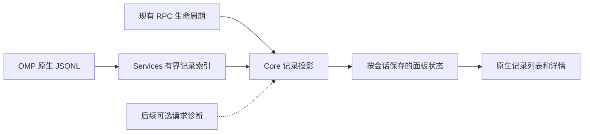

# 会话记录侧栏：OMP 数据与 pi-app 实现调查

日期：2026-10-24。范围：侧栏名称／图标调整，以及只读源码调查和实现建议。本轮没有实现记录面板、启动 GUI／OMP 会话或读取用户会话、配置与凭据。

## 结论

**OMP 18.12.5 已有足够数据实现有用的会话记录面板。** 第一版可以展示当前分支的用户输入、助手文字／可用思考内容、工具参数与结果、模型和推理档位变更、压缩／handoff、用量、费用及可用的响应时间指标。原生 JSONL 是事实来源，GUI 只做只读索引、分页和展示。

**现有历史不能等同于完整的模型请求诊断记录。** 原始发送载荷、完整系统提示／工具 schema、HTTP 元数据、所有底层尝试和未落盘的过程事件不能从普通消息无损还原。pi-app 为这些信息另外安装了采集器和诊断存储。建议先实现原生记录浏览，再独立评估增强采集；不要把“未采集”显示成空请求或零耗时。

本轮已将侧栏英文名改为 `Session history`、简体中文改为“会话记录”，图标改为 `road.lanes`。保留持久化标识 `trajectory`，原有选择页、页签、占位内容和辅助功能标签均复用同一注册表；面板仍为占位。Dev 版本为 0.1.251 / build 252。

## 调查基线与证据

- OMP GUI 起点：本地 `main`，`43b5858841ce769023514d5665e7f62dfab4f734`。
- 本机 npm 包：`@oh-my-pi/pi-coding-agent` 18.12.5；通过 `command -v omp` 解析安装位置，仅阅读包内源码。结论以这个安装版本为准，不按在线 `main` 推断本机能力。
- 参考项目：`/Users/developer/githubs/pi-app`，HEAD `8d754b781573f10161f9c20114b688cf4dfd600c`。工作目录存在未提交修改，包含轨迹面板及采集器；本报告参考读取时的工作目录内容，不能只凭 HEAD 重现。未改动该项目。
- [源码指纹清单](../evaluations/session-history-research-2026-10-24.json)记录所读关键文件的 SHA-256、包版本和来源位置，不包含会话内容。
- 在线交叉核对：[OMP RPC](https://github.com/can1357/oh-my-pi/blob/main/docs/rpc.md)、[会话存储](https://github.com/can1357/oh-my-pi/blob/main/docs/session.md)、[SDK](https://github.com/can1357/oh-my-pi/blob/main/docs/sdk.md)。这些链接随上游变化；下面的字段和限制已另外核对安装源码。

OMP 源码位置以该 npm 包为根；`pi-ai` 和 `pi-agent-core` 位于其 `node_modules/@oh-my-pi/`。

| 证据入口 | 核对内容 |
| --- | --- |
| `src/modes/rpc/rpc-types.ts`、`rpc-mode.ts`、`rpc-compat.ts` | 公开查询、`since`、原生状态和分页拒绝条件 |
| `src/modes/rpc/rpc-messages.ts`、`rpc-subagents.ts`、`rpc-session-events.ts` | 页大小、游标、子代理字节读取、流式消息身份 |
| `src/session/session-entries.ts`、`session-manager.ts` | 会话头、父链、活动叶、条目类型和 SDK 读取接口 |
| `src/session/agent-session.ts`、`session-stats.ts`、`session-persistence.ts` | 实际持久化、统计范围、截断与 blob 外置 |
| `pi-ai/src/types.ts`、`pi-agent-core/src/types.ts` | 响应、工具结果、时间、错误和事件字段 |
| `src/extensibility/extensions/types.ts`、`runner.ts`、`src/sdk.ts`、`pi-agent-core/src/agent.ts` | 公开载荷／响应 hooks、回调顺序和 `agent.streamFn` |

## OMP 能提供什么

| 面板信息 | 可用数据 | 展示边界 |
| --- | --- | --- |
| 记录身份、顺序和分支 | `SessionEntry.id/parentId/timestamp`；查询返回 `leafId`；离线条目可有 `activeLeafId`；会话头含 `id/cwd/parentSession` | 按父链选当前分支，不能把文件追加顺序当作当前对话顺序；离线 `activeLeafId: null` 也有语义 |
| 用户与助手内容 | `message.role/content`；助手支持文字、thinking、redacted thinking、图片、`toolCall` 等块 | 只展示原生实际保存的可见内容；隐藏／删减的思考与缺失图片不可恢复 |
| 工具输入和输出 | 助手 `toolCall.id/name/arguments`；`toolResult.toolCallId/toolName/content/details/isError` | 通过调用 ID 关联；保留 xdev/eval 原始结构，复用现有工具身份投影；未找到结果不等于仍在运行 |
| 模型与请求结果 | 助手 `provider/model/api/responseId/upstreamProvider/upstreamModel/serviceTier/stopReason` | 很多字段可缺失；模型请求结束不等于工具完成或整个运行结束 |
| 响应时间 | 助手可带 `duration`、`ttft`、`completedAt` 和 `timestamp` | OMP 已持久化这些字段，不必为所有历史时间重建采集器；部分 provider 不填 `duration/ttft`，`completedAt` 为会话层结束时刻，不能混作服务器耗时 |
| 用量和费用 | 助手 `usage`；独立 `model_usage` 条目含 `purpose/role/model/usage/stopReason` | 用原生值并注明范围；缺失不填零；子代理汇总和子会话明细不能重复相加 |
| 错误和重试 | 助手 `errorMessage/errorStatus/errorId/retryRecovery`；实时 `auto_retry_start/end`、fallback 事件 | 可以解释已保存失败和恢复，不能声称包含每次 HTTP／WebSocket 尝试；部分空错误或分类调用不会作为普通消息保存 |
| 压缩和 handoff | `compaction.summary/firstKeptEntryId/tokensBefore/tokensAfter/method/details`；`branch_summary`、`reset_boundary` | 当前模型上下文与历史记录不同；仍存在的压缩前祖先可浏览，已被原生重写／删除的内容不可伪造 |
| 配置与其他记录 | `model_change`、`thinking_level_change`、`service_tier_change`、title、custom 等条目 | 宽松读取未知类型；显示已知字段并允许有界原始详情，不把内部凭据引用当作普通面板内容 |
| 实时执行 | agent／turn／message／tool 生命周期，压缩、重试、队列、notice；`prompt_result`、`session_settled` | 可做实时状态投影；事件到达时钟是 GUI 观测时间，不是原生精确执行时间；事件本身未必持久化 |
| 子代理 | `get_subagents`、progress/events 订阅、`get_subagent_messages` | 复用 Hydra 的已知观察身份和可见租约，不扫描任意路径或自建 worker 管理器 |

`contextSnapshot` 只有 token 构成与压缩 epoch 等摘要，**不包含完整请求正文**。`providerPayload` 是原生重放所用的不透明数据，也不是可以直接标成“实际 HTTP 请求”的通用字段。

`get_session_stats` 在本版本统计当前 `agent.state.messages`，并纳入对应活动窗口的 `model_usage` 及 task 结果汇总。它不是整个 JSONL、所有旧分支或全部子会话的历史总账。首版可以原样展示“OMP 当前统计”，不另造一个看似相同却口径不同的总费用。

## 读取接口是否适合直接驱动列表

| 接口 | 语义与限制 | 建议用途 |
| --- | --- | --- |
| `get_entries(since?)` | 全部追加历史及活动叶；`since` 为某个持久条目之后的全部记录，未知 ID 返回 `unknown_since`；没有 `limit`、详情字段选择或服务端搜索 | 已连接、小会话的快照／增量核对；不要每次打开或流式刷新都拉全量 |
| `get_tree` | 返回带完整条目的原生树与活动叶，没有分页 | 小型分支导航辅助；不作为大历史列表的默认入口 |
| `get_messages` | 当前内存中的上下文消息，已受压缩等处理影响 | 当前上下文检查，不代替完整会话记录 |
| `get_messages_page` | 默认 100 条，上限 256；按时间从前向后；通常 768 KiB，单条可超限；cursor 绑定会话、活动叶和消息数量 | 需要当前上下文消息时使用；streaming/compacting 返回 `session_busy`，改变快照返回 `stale_cursor`，没有任意页跳转或按 ID 读详情 |
| `get_subagent_messages(fromByte)` | 仅允许已登记子会话；返回完整换行记录、`nextByte/reset`；18.12.5 从指定位置读到末尾，没有最大条数参数 | 复用已有可见租约和字节游标；首次读取仍可能很大，不能把字节游标误当成服务端大小限制 |
| `SessionManager.getEntries/getEntry/getBranch/getTree/getLeafId` | 公开 SDK 在已打开会话上读取，不等于跨进程有界 RPC | 未来同进程桥可输出受限投影；只读面板不应另建 `AgentSession` 或抢占单一 `onEntryAppended` 复制回调 |
| 已记录 `sessionFile` 的原生 JSONL | 可在无运行进程时只读；含持久身份和仍保留的完整分支信息 | 首版离线浏览基线；使用独立的有界索引，不复制整份原始日志进 GUI 会话存储 |

protocol v2 分帧仅解决传输帧大小，不能解决全量对象的内存成本。现有 GUI chunk assembler 还有 64 MiB 总帧上限。因此不能用“已支持 v2”解释无限量 `get_entries/get_tree` 是安全的。

原生存储也有保真边界：普通超大字符串可能按 500,000 字符阈值截断，部分带签名／重放意义的内容走例外路径；图片可能转成 blob 引用。直接读 JSONL 时应保留截断／外置标记，首版不自行扫描外部 profile 的 blob 目录，也不把引用当作 base64 图片。

## pi-app 的实现及值得借鉴的部分

参考文件均来自前述本地工作目录：

| 文件 | 实际职责 |
| --- | --- |
| `src/shared/trajectory.ts` | `run/user/assistant/request/tool/compaction/retry/notification` 类型；状态、时间、模型、用量、调用关联及 `captured/captureError` |
| `src/main/pi/trajectory/recorder.ts` | 包装 Pi 的 `agent.streamFunction`，采集变换后的上下文、回调替换后的载荷、安全选项、响应元数据与最终输出；逐次尝试记录；不保留全部流式 delta |
| `src/main/pi/trajectory/storage.ts` | SQLite/WAL、SHA-256 内容节点去重、记录索引、当前分支／父会话校验、历史补读和惰性详情 |
| `src/main/pi/trajectory/jsonl.ts` | 增量读完整 JSONL 行，16 MiB 行阈值，超大行保留有限身份信息 |
| `src/main/pi/trajectory/client.ts` | 懒创建 I/O worker，最多八个已派发任务、FIFO、故障退避；不是模型运行调度器 |
| `src/renderer/src/components/app/TrajectoryPane.tsx` | 主／子会话来源、搜索和类型／状态过滤、80 条分页、工具调用跳转、详情检查与导出；一次一个列表查询、通知合并至约 1 Hz、迟到结果隔离 |
| `src/renderer/src/components/app/TrajectoryRecordRow.tsx` | 简短预览、原生工具图标、结果状态、可用耗时，点击调用定位具体执行 |

详情按 `context/payload/options/response/output/event` 分文档；一次最多 40 个字段或 16,384 个 Unicode codepoint，展开节点才读下一片。窄布局上下排列列表和检查器，宽布局左右分栏，并保留分隔比例。历史还原记录明确标记 `captured: false`，没有录到的载荷不会被当前配置补造。

**建议借鉴信息架构、有界读取和来源标记，不直接移植 Pi 协议适配。** OMP 的模型变更字段、额外条目和生命周期有差异：OMP 使用 `agent_end.isTerminal/yielded`、`prompt_result/session_settled`，没有 Pi 的 `agent_settled`；本机 OMP 的流函数名是 `agent.streamFn`。pi-app 的历史索引按其自身 Pi 格式处理，不能原封照搬到 OMP 的 `activeLeafId`、标题原位更新、blob 和历史重写语义上。

## 推荐的第一版

范围为当前会话的只读记录浏览；子代理作为来源选择，仍使用现有 Hydra 身份。第一版不新增原生 branch/fork/rewind 操作。

### 数据与实现位置

1. **Core 模型**：新增独立 `OMPSessionRecord`／查询与详情 DTO，保留 native entry、parent、tool call、内容片段、原生元数据、来源和完整性。不要扩大现有聊天时间线为原始协议数据库。未知类型保留身份，非法父链／重复身份显式报告。
2. **Services 索引**：新增串行 actor，按会话文件身份建立轻量 ID／父链／偏移／摘要索引，详情按偏移读取。首版可用内存索引，继承现有 64 MiB 文件、50,000 条记录的总预算；另给单行／详情上限和取消检查。超过范围明确提示，后续确有长历史需求再升级可重建的磁盘索引，避免一开始复制 pi-app 的完整诊断数据库。
3. **读取与刷新**：只访问当前 GUI 库内已绑定的原生会话路径，沿用现有规范化路径和 symlink 检查。只在面板可见时监听；隐藏取消读任务，保留轻量导航。现有运行时事件只负责使缓存失效和提供有界实时状态，合并刷新且最多一个读取在途。查看旧记录不启动、恢复或保持 OMP 进程存活。
4. **分支与重写**：在线优先使用可信活动叶，离线严格区分 `activeLeafId` 缺失、字符串和 `null`。仅完整换行后推进游标；文件替换／截断／旧行改写时重建索引，不能只凭文件变长认定纯追加。固定标题槽的变化也要与历史正文区分。`since` 只补新增条目，不能发现已存在条目的改写。
5. **运行时接入**：在 [OMPSession](../../OMPGUI/Services/Providers/OMPSession.swift) 接收到原始事件后做轻量投影，再复用 [OMPEventDecoder](../../OMPGUI/Services/Providers/OMPEventDecoder.swift) 的聊天路径。运行中的临时记录以连接身份加 RPC `messageId` 标识；持久行以会话身份加 entry ID 标识。`msg-N` 只是连接内序号，不能直接当原生 entry ID，不能仅按相同正文／时间戳合并。未能严格关联时保留“实时观察”与“原生记录”的区别。
6. **UI**：接入 [WorkspaceSidebarPane](../../OMPGUI/App/Preview/WorkspaceSidebarPane.swift)；面板选择、滚动、筛选、页游标和详情选择放在当前会话的 [PreviewSession](../../OMPGUI/App/Preview/FilePreviewStore.swift)。复用 Git／Debug 的列表、返回和全屏分栏模式。普通窄侧栏采用列表→详情，全屏左右分栏；切回保留阅读位置，新记录不抢走用户固定的历史选择。

当前 [OMPHistory](../../OMPGUI/Core/Models/OMPHistory.swift) 为用户消息编辑／分支而设计，仅投影角色、文字、图片和摘要，不能直接作为工具／请求检查器 DTO。[nativeHistory](../../OMPGUI/Services/Providers/OMPSession+History.swift) 又要求空闲并读取完整 entries，应保留其编辑安全契约，另设只读浏览服务。[OMPAgentJournal](../../OMPGUI/Services/Providers/OMPAgentJournal.swift) 可复用路径／完整行／父链原则，但当前是整文件有界读取，不能宣称已具备偏移分页。

### 面板内容与资源预算

- 顶栏提供来源、类型／状态过滤和搜索；首版搜索明确覆盖索引中的名称、模型、工具、摘要，不声称检索了未加载全文。
- 列表一页 80 条，单条摘要最多 512 字符；默认跟随最新，手动选择旧记录后固定。用户输入、模型响应、工具、压缩、配置变化使用各自语义图标。
- 详情展示基本元数据、输入／输出／结构化详情、用量和可用时间；JSON 节点按 40 个字段或 16 Ki 字符分片，有深度与累计缓存预算。原生没有的值显示未知／未记录。
- 时间来源单列：原生 `duration/ttft/completedAt` 与 GUI 接收时间分开。普通工具结果没有统一开始时间，只有观察到匹配 start/end 的本次连接才能提供“观测耗时”。
- 只对搜索输入与紧凑操作按钮使用共享 Chrome 玻璃；列表、JSON 树、状态和详情采用普通原生布局与分隔线。保留无障碍、减少透明度／动态效果回退及 zh-Hans。
- 详情与导出每次复核会话、文件、分支和记录身份；不把先前页面中出现过的 ID 当作永久访问许可。首版优先提供片段复制，完整记录导出与增强诊断一并评估，不导出凭据引用或未经筛选的 provider 内部字段。

## 后续增强采集的可行性与限制

OMP 公开扩展有 `before_provider_request(payload)` 与 `after_provider_response(status, headers, requestId, metadata)`；已存在 SDK host 也可以研究包装公开 `session.agent.streamFn`。因此新请求的增强诊断在技术上可行，但本轮只确认源码入口，尚未证明全 provider、子代理和辅助模型调用均覆盖。

建议增强阶段按以下约束实施：

- 通过现有 [SDK host](../../OMPGUI/Resources/OMPSDKHost.js) 或原生扩展接入；保持原函数、回调返回值、异常、取消及原生调度。直接 CLI／旧 SDK 仍提供第一版历史，增强能力明确不可用。
- 原生 payload hooks 按扩展顺序依次替换载荷，某个普通观察 hook 看到的可能不是最后版本。若包装 stream，应先执行原有 `onPayload`，再只读快照其有效返回值；仍需验证 provider 后续 transport 变换，不能未经验证宣称是最终网络字节。
- 请求、重试尝试、工具执行、子代理、压缩辅助调用分别关联；`requestId` 可能缺失，压缩／旁问／子代理可能走不同模型调用路径。关联不确定时不要挂到最近的一条助手消息。
- 仅保存经过白名单投影／脱敏的选项与响应头；不序列化认证对象、cookie、回调闭包及任意环境。原始内容采用惰性文件／节点存储，GUI 会话只保留引用和有界摘要，不逐 token 持久化。
- 给记录队列、单条正文、总磁盘保留和导出设置明确预算；诊断写入失败标记不完整，不能让模型执行失败或产生无限积压。所有诊断留在本 edition 数据目录，不写 OMP profile。
- 历史没有采集过的内容保持缺失；错误链只展示 OMP 已提供的信息，不照搬 pi-app 的 provider 源码补丁来声称恢复已丢失的原因。

## 实施次序与验收建议

第一阶段完成原生条目读取／身份和记录投影；第二阶段接入分页列表、惰性详情、过滤及全屏布局；第三阶段才做独立的请求采集试验。这是建议，不是本轮已完成的功能。

未来实现的最小功能检查应使用合成日志／RPC fixture，覆盖父链与 off-branch `activeLeafId`（含 null）、压缩和重写、重复文字／ID隔离、缺失工具结果、模型／时间字段缺失、超大和半行、blob／截断、分页与迟到结果、隐藏取消、主／子会话隔离及持久页签恢复。使用行为测试，登记一次，不镜像实现。

增强采集进入开发后，再单独选择隔离原生 SDK 与确定性本机 provider 检查：回调替换顺序、取消、重试、请求归属、辅助调用范围、失败不干扰执行。真实账号、GUI 可见交互及大负载测量仍为单独验收项，不能由本次源码调查代替。

## 本轮验证

- `make build`：通过，工作树 Dev 构建；未安装或启动。
- `make verify AREAS="preview-store"`：通过。覆盖现有页签路由、保存／恢复、延迟恢复、全屏及生命周期；没有为名称／图标变更添加实现镜像测试。报告：`build.noindex/verification/runs/20261024T050943Z-8a3f757b/report.json`。
- `make verify TIER=static AREAS="documentation"`：通过，87 份 Markdown、805 个本地链接全部可达。报告：`build.noindex/verification/runs/20261024T051445Z-ff6a902f/report.json`。该检查只校验文档链接／导航，不证明上述未来方案已实现。
- 未执行 OMP 原生集成、付费模型调用、GUI 视觉验收或性能基准。原生字段的实际填充取决于具体 provider／会话，增强采集覆盖仍需后续隔离验证。
