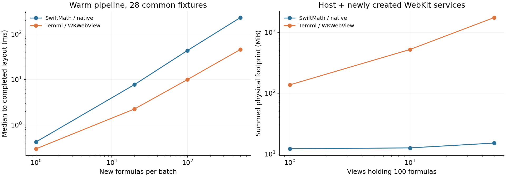
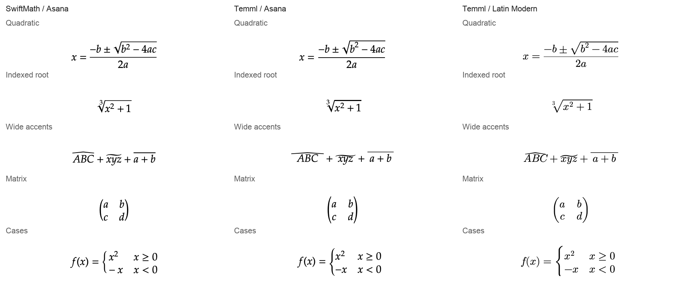

# SwiftMath 完整替换为 Temml 的实测评估

> 历史记录：仅代表原文所列日期、版本及验收范围，不是当前操作指南。 当前已移除的收件箱、会话记录、独立 fork 和诊断入口不因本文的历史描述而恢复为功能。 当前入口见[文档索引](../README.md)和[功能状态与验收边界](../status.md)。

对当前 OMP GUI，**不建议把完整替换当作性能或低资源占用优化**。Temml 的优势是更广的数学语法、中文公式文本和较小的离线资源包；已经运行的 WebKit 批量排版新公式也明显更快。代价是浏览器进程的固定开销，以及保留原生正文、复制和矢量绘制时需要的桥接成本。优先级若改为数学兼容性，替换有价值，但应作为渲染架构迁移评估。

实测日期为 2026 年 10 月 13 日，硬件为 Apple M5 MacBook Air、24 GB 内存，系统为 macOS 27.2（26B5101f），Xcode 27.0。基线提交为 `1a029005b6fefea7d351b00438334986110f5cf8`。比较项目锁定的 SwiftMath 1.7.3 与 Temml 0.14.0，使用当前生产 `MathRendering`，独立 Release CLI、15 pt 字号、同为 2× 的离屏图像。Temml 比较系统 STIX Two、同源 Asana 和 Latin Modern 三种字体。

## 当前实现与替换边界

当前公式是 TextKit 中的原生矢量附件。`MathRendering` 同步生成 SwiftMath displayList，缓存键为 TeX、inline/display 模式和字号；宽度、外观变化复用矢量几何。缓存上限为 256 条与估算成本 4 MiB，这不是整个渲染器的实际内存硬上限。超宽附件通过 `MathParagraphHost` 横向滚动，周围正文继续按可见宽度换行。未闭合公式保持源码，不进入引擎。

Temml 输出 MathML，排版由浏览器完成。用 JavaScriptCore 转换后，直接调用 AppKit 的 HTML 富文本导入，测试分数 `\frac{a+b}{c+d}` 得到 `a、+、b、c、+、d` 的普通文字和换行，附件数为零，分数结构丢失。**现有 TextKit 路径无法通过换一个解析库直接接收 Temml 输出。** JavaScriptCore 加载核心脚本约 4.8 ms、转换 28 个共同支持的样例约 2.0 ms，但这只是转换成本。

可落地的方向是让正文进入 WebKit，或保留原生正文、用共享 WebView 导出 PNG/PDF 附件。本次分别测量这些方向的核心路径，没有修改产品渲染实现。产品构建 `make build` 与既有 `check_markdown_math.sh` 均通过。

## 性能

性能只采用双方通过的 28 个核心样例，循环组合并附加不同数值生成新缓存键。以下为中位数；暖批次每组 21 次，缓存与重排每组 41 次。WebKit 列为系统字体版本，另外两种字体的 DOM 批量性能相近。

| 场景 | 当前原生路径 | Temml 与 WebKit | 含义 |
| --- | ---: | ---: | --- |
| 新进程首次公式完成布局 | 14.11 ms | 167.42 ms | 各九次新进程，包含引擎首次初始化，系统文件缓存已热 |
| 新进程首次公式完成离屏图像 | 15.36 ms | 170.71 ms | 公式为 display 二次方程 |
| 1 个新公式完成布局 | 0.43 ms | 0.30 ms | 暖引擎，含本地/跨进程调用 |
| 20 个新公式完成布局 | 7.76 ms | 2.26 ms | 原生含附件创建和 TextKit 布局 |
| 100 个新公式完成布局 | 43.41 ms | 9.98 ms | P95 分别为 43.96、10.54 ms |
| 500 个新公式完成布局 | 229.44 ms | 45.65 ms | 稠密新内容时浏览器批量路径占优 |
| 100 个新公式完成 720×900 pt 图像 | 45.01 ms | 11.77 ms | 只绘制可见区域，均为 2× |
| 100 个已缓存公式重新建立显示内容 | 1.83 ms | 8.07 ms | 原生缓存几何；Temml 缓存 MathML 后重建 DOM |
| 上一项再完成离屏图像 | 2.69 ms | 9.45 ms | 包含离屏绘制与 WebKit 图像回传 |
| 100 个公式在 696/280 pt 间重排 | 0.55 ms | 0.23 ms | 各自合成页的布局，均无需重解析 TeX |
| 切换前景色并产生图像 | 1.21 ms | 3.45 ms | 原生重绘与 WebKit 快照路径 |

原生从缓存创建 100 个附件另测 101 次，中位数约 0.68 ms，新增排版次数为零。上述缓存比较是为已知内容重新建立显示内容；保留现有视图且内容未变时，两者都可以跳过更新，不能将这张表解释成 WebKit 每次重绘必然重建 DOM。

Temml 的 100 个公式转换成 MathML 字符串约 1 ms，DOM 排版和桥接把完整布局成本提高到约 10 ms。浏览器计时存在约 1 ms 量化，单公式的 0 不代表零成本。表格采用 Swift 单调时钟的外部计时。

当前生产 `MathRendering` 位于 MainActor；新公式同步排版会占用主线程。WebKit 的转换与数学布局在独立进程中完成，这对长回复的交互有潜在收益。不过合成批次不等于实际时间线：本次没有将数值折算成整应用滚动帧率、能耗或真实对话命中率。

## 保留原生正文时的桥接实测

同样是 100 个新公式、已启动的共享 WebView。PNG/PDF 逐公式路径各测 11 轮；PNG 包括转换、几何测量和图像回传，PDF 还包括 `NSImage` 解码。批量 PDF 导出一页，再让可见附件分别裁切绘制同一页。

| 接法 | 系统 STIX Two | Asana | Latin Modern | 结果 |
| --- | ---: | ---: | ---: | --- |
| 逐公式导出 PNG | 45.94 ms | 45.95 ms | 45.41 ms | 与原生完整图像约 45 ms 接近，逐公式桥接抵消批量优势 |
| 逐公式导出矢量 PDF | 360.13 ms | 190.60 ms | 258.01 ms | 可获得 `NSPDFImageRep`，字体子集重复嵌入成本显著 |
| 100 个独立 PDF 的编码数据 | 12.93 MiB | 4.54 MiB | 8.50 MiB | 仅编码数据，不等于解码后的常驻内存 |
| 共享批量 PDF 准备与区域绘制 | 114.99 ms | 84.26 ms | 94.68 ms | 降低导出次数，但每个附件绘制仍需解释共享页 |
| 共享批量 PDF 编码数据 | 约 162 KiB | 约 79 KiB | 约 122 KiB | 共享字体资源使数据量大幅下降 |

三个独立 PDF 样例均含嵌入的数学字体、没有图像 XObject，经 Poppler 以 4× 渲染检查，根号和分数线完整。**Temml 能通过 PDF 保留矢量清晰度，因此不能把“替换必然变成位图”作为结论。** 但此路径目前的生成成本更高。批量共享 PDF 可以继续优化，裁切绘制的重复解释成本也需要处理；该原型的值不能替代生产附件和完整时间线验收。

PNG 在当前 2× 尺度下清晰，改变字号或显示倍率需要新图。单色图像可考虑模板着色，显式多色公式还需要单独处理。PDF 可随缩放保持矢量质量，但其内置颜色、基线、区域裁切与缓存寿命同样需要桥接。这里的测试没有实现产品中的异步占位、过期结果取消、附件装配或主题缓存。

## 内存与 CPU

内存为独立宿主及本次新建 WebContent、GPU、Networking 进程的账本之和；不是整个 OMP GUI 的占用。每组测三个新进程，每次就绪后取七个样本。physical footprint 来自 `proc_pid_rusage`，同时记录 RSS；RSS 包含重复统计的共享页。跨进程账本之和也不能严格等同于整机新增唯一物理页。

| 内容与显示视图数量 | 原生 footprint | WebKit footprint | 原生 RSS | WebKit RSS | 宿主与服务进程数 |
| --- | ---: | ---: | ---: | ---: | --- |
| 0 公式、1 视图配置 | 5.8 MiB | 114.8 MiB | 27.0 MiB | 148.6 MiB | 1 / 4 |
| 1 公式、1 视图 | 8.8 MiB | 116.4 MiB | 59.8 MiB | 150.1 MiB | 1 / 4 |
| 100 公式、1 视图 | 12.2 MiB | 136.8 MiB | 63.3 MiB | 173.6 MiB | 1 / 4 |
| 500 公式、1 视图 | 24.0 MiB | 175.2 MiB | 75.1 MiB | 209.6 MiB | 1 / 4 |
| 100 公式、10 视图 | 12.6 MiB | 522.2 MiB | 63.6 MiB | 554.9 MiB | 1 / 13 |
| 100 公式、50 视图 | 15.1 MiB | 1743.7 MiB | 66.1 MiB | 2130.0 MiB | 1 / 53 |

原生 0 公式组只有宿主基线；WebKit 0 公式组已经加载脚本、字体并完成空页快照。不同 WebView 共享非持久化 data store，当前系统仍为这些实例创建多个 WebContent 进程。**按公式或段落分配常驻 WebView 的接法不适合当前时间线。** 使用一个共享公式 WebView 或减少同时存活的消息 WebView，才能控制固定成本。表中的 DOM 页面占用也不代表共享 PNG/PDF 方案最终占用，后者还有附件缓存。

从进程启动到首个含 100 公式的页面就绪并稳定，累计 CPU 时间中位数约为原生 81 ms、WebKit 254 ms；500 公式为 264 ms、309 ms。它们包含初始化和第一张快照，不能用于反驳暖批次中 WebKit 更快的结果。Mach 时间按系统 timebase 换算，子进程 CPU 计入总数。

## 离线资源体积

实测 Dev app 的 `SwiftMath_SwiftMath.bundle` 为 7,364,405 字节，即 7.02 MiB，主要是完整字体与度量资源。Temml 所需离线资源按原始文件字节计算如下；完整可执行文件的移除差值没有作为此表的测量对象。

| Temml 字体方案 | JS、CSS 与必要字体 | 相对当前 SwiftMath 资源包 |
| --- | ---: | ---: |
| 系统 STIX Two 与辅助字体 | 186,277 字节，0.18 MiB | 约少 6.85 MiB |
| 同源 Asana OTF | 610,318 字节，0.58 MiB | 约少 6.44 MiB |
| 同源 Latin Modern OTF 与辅助字体 | 920,309 字节，0.88 MiB | 约少 6.15 MiB |

chemistry 与 physics 两项浏览器扩展合计再增加 42,217 字节，约 41 KiB。此表未加许可证文本和产品桥接代码。WebKit 为系统框架，应用不需分发一个浏览器，但其运行时成本仍然存在。资源瘦身也可以单独评估：当前 SwiftMath 包含了多种字体，而产品固定使用 Asana，不能把全量字体的 7 MiB 都解释成原生排版的必然成本。任何调整仍须保留字体许可、第三方署名与项目既有归属说明。

## 语法兼容性

68 个有效样例、6 个无效样例。通过定义为没有引擎错误且得到非空布局；另对关键样例做视觉检查。样例有意包含较多扩展和边界，**53% 与 97% 是本样例集通过率，不是日常回复成功率或完整 LaTeX 兼容率**。

| 样例组 | 当前原生路径 | Temml 核心 | Temml 加 chemistry 与 physics |
| --- | ---: | ---: | ---: |
| 常用数学，36 条 | 28/36 | 36/36 | 36/36 |
| 扩展与 Unicode，28 条 | 4/28 | 26/28 | 28/28 |
| 长公式、大矩阵和深分数，4 条 | 4/4 | 4/4 | 4/4 |
| 有效样例合计 | 36/68 | 66/68 | 68/68 |
| 正确拒绝无效输入 | 4/6 | 6/6 | 6/6 |

分数、根号、求和、单积分、矩阵、`cases` 和 `aligned` 等当前原生能力可用。Temml 额外通过本集中的 `\operatorname`、`\boxed`、`\cancel`、扩展箭头、更多 AMS 环境、宏定义等。核心版的两个失败是 `\ce` 与 physics 组合，加载扩展后通过，不能把 npm 的服务端包默认包含扩展与浏览器核心版混为一谈。[Temml 官方扩展说明](https://temml.org/docs/en/administration#extensions)

中文 `\text{当且仅当中文条件成立}`、混合文本及 emoji 在 Temml 中得到非空布局，中文样图确认有实际字形。原生当前路径在进入 SwiftMath 前检查固定 Asana 的字符集并拒绝这类内容；这是当前实现与字体策略的边界，不能推广为所有原生数学库必然不支持中文。

原生接受了测试集中的裸 `\sqrt` 和 `x^2^3`，而 Temml 的 `throwOnError:true` 拒绝二者。Temml 默认错误展示方式与当前产品的源码回退不同，迁移时需要显式设置错误策略。现有输入长度、深度与未完成公式保护也应继续保留；测试使用 `trust:false`、有限 `maxExpand` 和 `maxSize`。

完整逐项结果与源公式见 [compatibility.csv](../evaluations/2026-10-13-swiftmath-temml/compatibility.csv)。

## 渲染与排版效果

同样使用 Asana，两者的常见分数、矩阵和分段公式都可辨读，但间距、装饰符与行盒不完全相同；改为 Latin Modern 又会改变字宽、笔画和根指数位置。当前样图不支持“常用公式换成 Temml 就全面更漂亮”的判断。对于原生不支持而显示源码的箭头、中文和扩展命令，Temml 的可读性收益明确。

中文公式中的字体回退呈现衬线字形，与 Chrome 正文的系统无衬线中文有差别，需要明确 `mtext` 字体策略。系统字体、Asana 和 Latin Modern 的根号、上标、括号与伸缩装饰符也应按实际 macOS 版本验收。共享 PDF 原型的 Asana 单字符 `\bar{y}` 横线与主体明显分离，在 [直接 WebKit 预览](../evaluations/2026-10-13-swiftmath-temml/temml-asana-atlas-screen.png) 中也能观察，原型的 inline 展示样式需要回归验证。原始宽高数据包含浏览器行盒/块级留白，不能直接当作字形正确性的量化分数；语法成功也不保证装饰符排版合格。

本机的长公式测试为 30 个下标项。在 `wrap:"tex"`、inline/display、annotation 开/关组合下，把容器从 696 pt 缩到 280 pt，公式宽度仍约为系统字体 1066 pt、Asana 1014 pt、Latin Modern 1091 pt，没有软断行。原生同样保持原字号并横向滚动。Temml **没有在本机解决自动公式断行**，这也与其官方 WebKit 限制说明相符。[Temml 的 wrap 与浏览器限制](https://temml.org/docs/en/administration#options)

显式多行结构可用；超宽公式仍应保持横向滚动策略。原生与浏览器两条路径在浅/深色下都完成了样图；PNG/PDF 附件路线的选中色、流式淡入与换屏倍率仍需接到当前 Chrome/TextKit 行为中。

原始 2× 样图包含 [原生浅色](../evaluations/2026-10-13-swiftmath-temml/swiftmath-light.png)、[Temml Asana 浅色](../evaluations/2026-10-13-swiftmath-temml/temml-asana-light.png)、[Temml Latin Modern 深色](../evaluations/2026-10-13-swiftmath-temml/temml-latin-dark.png)、[原生中英混排行内布局](../evaluations/2026-10-13-swiftmath-temml/swiftmath-inline.png)、[Temml 中英混排行内布局](../evaluations/2026-10-13-swiftmath-temml/temml-asana-inline.png)。完整三字体、双主题与批量 PDF 预览保存在同一数据目录。

## 选择和复制

原生选择导出返回原始带分隔符的 TeX；既有验证覆盖相邻公式、Unicode、换行、链接和 RTF。MathML 的默认选择文本在测试中返回拆开的符号与换行，没有原始 TeX。官方 copy-tex 扩展可以恢复 TeX，但需要 annotation；本版测试还显示，display 输入的 `$$...$$` 被其默认实现复制成 `$...$`。`\(...\)` 等原始分隔形式也不能仅凭 MathML annotation 恢复。[copy-tex 0.14.0 实现](https://github.com/ronkok/Temml/blob/4ffdf0e56577c426375d0b2818f8895edb5e5030/contrib/copy-tex/copy-tex.js)

所以原始 `MarkdownFormula.source` 仍应作为复制与辅助功能的来源。保留原生附件可复用现有导出逻辑；正文迁入 WebKit 则需要接回整条消息复制、原生选择、链接与头像悬停。宏、编号和跨公式引用还需要按消息维护上下文，缓存不能只看孤立 TeX。[Temml 宏与引用说明](https://temml.org/docs/en/administration)

## 替换方案取舍

| 路线 | 主要收益 | 主要代价 | 对当前产品的判断 |
| --- | --- | --- | --- |
| 保留 SwiftMath | 低占用、原生矢量和缓存、现有交互完整 | 当前扩展、中文与部分数学命令覆盖不足 | 原生体验与低占用优先时继续保留 |
| 每公式或段落一个 WebView | 接入局部视图较直接 | 实测多进程占用迅速增长，选择边界增多 | 不采用 |
| 每条回复或少量区域使用 WebKit | 批量新公式布局快、MathML 与丰富语法 | 正文与原生交互迁移，存活视图数要受控 | 数学文档体验优先时可作为重构方向 |
| 一个共享 WebView 加 PNG 附件 | 原生正文、宽泛语法，暖生成约与原生相当 | 固定浏览器占用、倍率/颜色/异步缓存，输出为位图 | 兼容性需求明确时可做接入原型 |
| 一个共享 WebView 加独立 PDF 附件 | 保留矢量、复用原生正文 | 逐公式导出与重复字体嵌入成本高 | 当前实测成本不利于完整替换 |
| 共享 WebView 加批量 PDF | 矢量与字体资源可共享 | 导出、区域绘制、缓存分组与流式更新更复杂 | 有优化空间，当前原型仍慢于原生 |

目前建议保留主渲染器，把兼容性缺项与资源瘦身分别立项。若模型回复中的中文公式、`\boxed`、扩展箭头、化学等已经是主要使用场景，Temml 值得采用；应优先限定共享 WebView 数量，再选择正文 WebKit 或原生附件桥接。完成取消过期结果、基线、主题与倍率、复制、消息内宏上下文、超宽滚动的接入验收后，再决定完整移除 SwiftMath。

## 复现与数据

[测试脚本与方法](../../tests/benchmarks/math_renderers/README.md)、[性能逐项 CSV](../evaluations/2026-10-13-swiftmath-temml/performance.csv)、[概要 JSON](../evaluations/2026-10-13-swiftmath-temml/summary.json) 与 [完整原始样本 gzip JSON](../evaluations/2026-10-13-swiftmath-temml/measurements.json.gz) 随本次评估保存。完整样本包含每次耗时、公式输入、MathML、进程身份、RSS、footprint、CPU、字体与 PDF 验证结果。

这是这台机器与这个版本组合的渲染实验。项目最低支持 macOS 26；其 WebKit 字体与数学布局仍需在对应系统复测。对后续版本或新接法的判断应重新运行样例与关键布局检查，而非沿用本次通过率或耗时。
