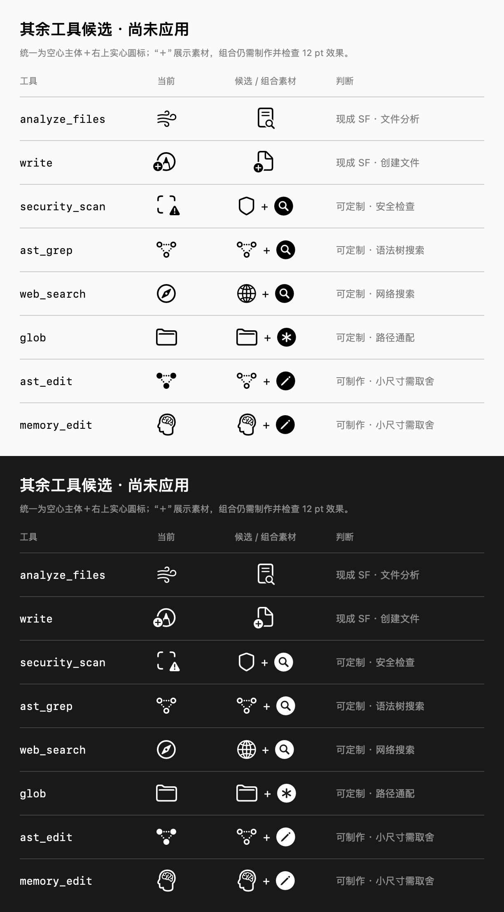

# 自定义 find SF 符号与工具图标核对（2026-10-28）

以下保留初次核对的方案与证据；随后 owner 指定的圆标放大、glob、read 与
analyze_files 调整见[后续记录](tool-symbol-refinements-2026-10-28.md)。

本次查看了 [63 个工具／动作映射](../OMP_TOOLS.md)，实际替换 `find`。
其余候选保留为建议。应用沿用 12 pt 符号字号、16 pt 槽位，以及原有的语义颜色、
失败／拒绝状态、图片读取与 Hydra/MCP 专用资产。

## 已应用：find

最终采用空心 `folder` 加右上角 `magnifyingglass.circle.fill`。复用 SF Symbols 27.0
导出的 `folder.badge.questionmark` 空心主体、圆标位置与外围挖空，
将原生 `magnifyingglass.circle.fill` 的各字重路径缩放到原圆标边界，替换问号圆标。
以 Xcode 26 及更高版本兼容导出为基础，保存为
[`tool-find-folder.symbolset`](../../OMPGUI/Resources/Assets.xcassets/tool-find-folder.symbolset)。
空心主体、放大镜形状及圆标外围均保留透明挖空，浅深色背景间不会留下白底；
保留三套字重母版及原生布局注释。初版实心文件夹加裸放大镜已按 owner 后续要求替换。
上方大图用于观察细节，下方工具行按 12 pt / 16 pt 原生尺寸绘制。

[`SFSymbolResource`](../../OMPGUI/UI/Common/TimelineRowIcon.swift)显式区分系统符号和
自定义符号资源，聊天、Hydra 工具步骤／进度与会话记录共用
[`OMPToolSymbols`](../../OMPGUI/UI/Common/OMPToolSymbols.swift)。直接 `find` 与
`write` 搭载的 `find` 设备解析到同一资产；未知扩展仍使用原来的精确身份回退。

## 其余候选

图中“＋”明确表示组合素材，并非已经导出的复合 SF 符号。
前两项直接展示现成 SF 候选；其余需要制作和小尺寸光学校正，均未应用。
所有自定义候选统一为**空心主体＋右上角实心圆形角标**；圆内符号和外围留白透明。

| 工具 | 当前问题 | 候选 | 判断 |
| --- | --- | --- | --- |
| `analyze_files` | `wind` 看不出分析已改文件 | `doc.text.magnifyingglass` | 优先；已有原生符号，无需定制 |
| `security_scan` | 取景框加警告更像相机扫描／已有风险 | `shield` 加 `magnifyingglass.circle.fill` | 优先；安全检查语义明确，可复用本次圆标流程 |
| `ast_grep` | 只表示节点连接，搜索动作不明显 | 空心语法树加 `magnifyingglass.circle.fill` | 值得试作；12 pt 下应减少虚线与节点细节 |
| `web_search` | `safari` 更像浏览器身份 | `globe` 加 `magnifyingglass.circle.fill` | 可定制；地球经纬线与圆标容易拥挤，宜简化地球 |
| `glob` | 文件夹没有表达路径通配 | `folder` 加 `asterisk.circle.fill` | 可定制；复用原生星号圆标路径，与 find 按圆内符号区分 |
| `write` | 圆形笔尖加号较复杂，文件对象不明显 | `doc.badge.plus` | 现成符号更简洁，但偏“新建”；现工具同时支持覆盖，语义需取舍 |
| `ast_edit` | 仅将节点填实，不易看出编辑 | 空心语法树加 `pencil.circle.fill` | 能制作，可复用原生铅笔圆标；12 pt 信息密度较高，暂缓 |
| `memory_edit` | 和 `think` 使用同一个脑部符号 | 简化空心脑部加 `pencil.circle.fill` | 能制作，但须简化底图；暂缓 |

`read`、`bash`、`grep`、`debug`、`eval`、`todo`、`goal`、图片／语音、
消息发送／等待／停止、确认／拒绝等已有清楚的原生表达，保留即可。
`retain`／`recall` 的入／出托盘方向也有区分，不必普遍增加角标。
`github` 的品牌识别不适合靠拼接普通 SF 图形模拟。

## 验证与边界

- SF Symbols 27.0 的“验证模板”：通过，三套变体均未发现问题，可导入 Xcode。
- `make build`：通过；空心／圆标版图标检查基于 Dev 0.1.332 / build 333。
  合入同期主线后最终 Dev 为 0.1.333 / build 334。
- `make verify TIER=functional AREAS="icons"`：通过，63 个原生身份、70 个可渲染符号资源，
  含精确身份／设备回退与站点图标外观等共 174 项检查。
- 功能报告：`build.noindex/verification/runs/20261028T044829Z-9010af73/report.json`。
- 对照图由[离屏 SwiftUI 渲染源码](../evaluations/2026-10-28-tool-symbol-audit/render.swift)
  使用当前 worktree 构建的应用资源生成，已查看浅深色输出。
- 本次没有启动或重启 OMP GUI；真实窗口的字号设置、VoiceOver 与 macOS 26 实机显示
  仍属于手动验收，不能由当前 macOS 27.2 的离屏结果替代。

资源维护和 Apple 来源见[图标指南](../../design/icons/README.md#custom-tool-sf-symbols)。
