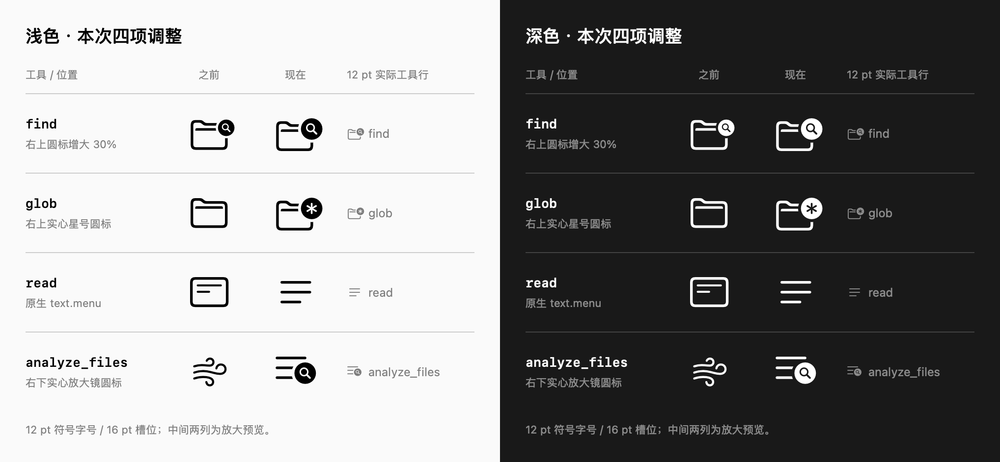

# 工具圆标放大、glob 与文本菜单图标（2026-10-28）

本次只调整 owner 指定的四项；[原候选核对](tool-symbol-audit-2026-10-28.md)中的
其他工具映射保留。源文件与几何规则见[图标指南](../../design/icons/README.md#custom-tool-sf-symbols)。

| 工具 | 最终图形 | 角标位置 |
| --- | --- | --- |
| `find` | 空心 `folder` ＋ `magnifyingglass.circle.fill`，圆标直径增大 30% | 右上 |
| `glob` | 空心 `folder` ＋ `asterisk.circle.fill`，与 find 同尺寸 | 右上 |
| `read` | 原生 `text.menu`；旧记录的读取类别回退同步更新 | 无 |
| `analyze_files` | `text.menu` ＋同尺寸 `magnifyingglass.circle.fill` | 右下 |

圆标围绕原生参考中心等比放大，外围挖空同时放大；主体路径、12 pt 符号字号、
16 pt 槽位、文字缩放、语义颜色和失败／拒绝状态均沿用原有呈现。
星号使用与外圆相反的轮廓方向，圆内符号和外围留白是真正透明挖空。
三套字重母版保留原生基线／顶线，尾侧边距纳入新增圆标宽度。
`analyze_files` 采用同一圆标尺寸，并将原生重叠比例映射到文本菜单右下角。

预览由[离屏 SwiftUI 源码](../evaluations/2026-10-28-tool-symbol-refinements/preview.swift)
生成。之前的 find 取自 `b3078fdb3` 版本的 SVG，其余之前图形为系统符号；
后方实际行按 12 pt / 16 pt 绘制，中间列放大以观察细节。

## 验证范围

选择一次增量 `make build`、`make verify TIER=functional AREAS="icons"`，以及
`make verify TIER=static AREAS="documentation"`。没有新增复刻映射的测试；
既有图标检查直接加载三项自定义 Symbol Image Set，并保留精确身份／设备回退检查。

- `make build`：通过，Dev 0.1.335 / build 336。
- `functional:icons`：通过，63 个原生身份、70 个可渲染符号资源，共 174 项相关检查。
- 功能报告：`build.noindex/verification/runs/20261028T053015Z-ffeaead5/report.json`。
- 对照图已从本工作树构建的应用资源重新生成，检查浅深色和 12 pt 实际尺寸。

没有启动或重启 OMP GUI。离屏结果不替代真实窗口、VoiceOver 和 macOS 26 实机验收。
